# Jarkom Modul 3 2026 K-09

| Nama | NRP |
| :--- | :--- |
| Sultan Ahmad Maulana Bahyshidqi | 5027251070 |
| Muhammad Razzan Azizi Djauhari | 5027251086 |

Dokumentasi pengerjaan Praktikum Modul 3 Komunikasi Data & Jaringan Komputer menggunakan GNS3 dengan prefix jaringan `10.68.x.x` dan domain internal `k09.com`.

---

## 1. Konfigurasi Topologi dan IP Address

jichi berfungsi sebagai router sentral yang terhubung ke NAT serta empat jaringan internal.

**Nama file foto:** `images/soal1/topologi.png`

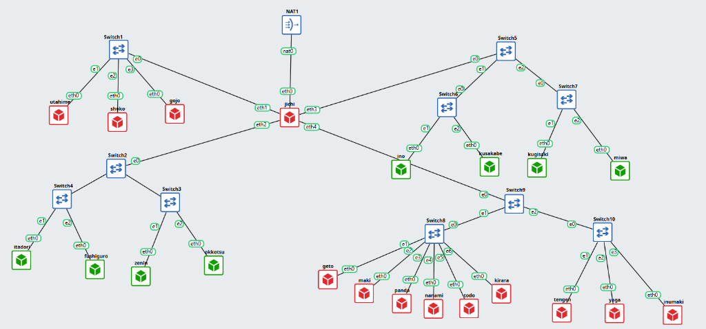

### Skema interface jichi

| Interface | Jaringan | Node |
| :--- | :--- | :--- |
| `eth0` | NAT / WAN | Internet |
| `eth1` | `10.68.1.0/24` (DMZ) | utahime, shoko, gojo |
| `eth2` | `10.68.2.0/24` (Divisi A) | itadori, fushiguro, zenin, okkotsu |
| `eth3` | `10.68.3.0/24` (Divisi B) | ino, kusakabe, miwa, kugisaki |
| `eth4` | `10.68.4.0/24` (Data Center) | tengen, geto, maki, panda, nanami, todo, kirara, yaga, inumaki |

Konfigurasi `/etc/network/interfaces` pada jichi:

```text
auto eth0
iface eth0 inet dhcp
    up sysctl -w net.ipv4.ip_forward=1
    up iptables -t nat -C POSTROUTING -s 10.68.0.0/16 -o eth0 -j MASQUERADE 2>/dev/null || iptables -t nat -A POSTROUTING -s 10.68.0.0/16 -o eth0 -j MASQUERADE

auto eth1
iface eth1 inet static
    address 10.68.1.1
    netmask 255.255.255.0

auto eth2
iface eth2 inet static
    address 10.68.2.1
    netmask 255.255.255.0

auto eth3
iface eth3 inet static
    address 10.68.3.1
    netmask 255.255.255.0

auto eth4
iface eth4 inet static
    address 10.68.4.1
    netmask 255.255.255.0
```

### Pengalamatan host infrastruktur

| Node | Peran | IP Address | Gateway |
| :--- | :--- | :--- | :--- |
| utahime | DNS Master | `10.68.1.2/24` | `10.68.1.1` |
| shoko | DNS Slave | `10.68.1.3/24` | `10.68.1.1` |
| gojo | Reverse Proxy | `10.68.1.4/24` | `10.68.1.1` |
| tengen | DHCP Server | `10.68.4.10/24` | `10.68.4.1` |
| geto | Load Balancer | `10.68.4.2/24` | `10.68.4.1` |
| maki | Web Frontend | `10.68.4.3/24` | `10.68.4.1` |
| panda | Web Frontend | `10.68.4.4/24` | `10.68.4.1` |
| nanami | Worker API Utama | `10.68.4.5/24` | `10.68.4.1` |
| todo | Worker API Utama | `10.68.4.6/24` | `10.68.4.1` |
| kirara | Worker API Cadangan | `10.68.4.7/24` | `10.68.4.1` |
| yaga | Database Master | `10.68.4.8/24` | `10.68.4.1` |
| inumaki | Database Slave | `10.68.4.9/24` | `10.68.4.1` |

Contoh konfigurasi interface host tengen (`/etc/network/interfaces`):

```text
auto eth0
iface eth0 inet static
    address 10.68.4.10
    netmask 255.255.255.0
    gateway 10.68.4.1
    up echo "nameserver 192.168.122.1" > /etc/resolv.conf
```

Verifikasi konfigurasi dan NAT pada jichi:

```bash
ip -br a
cat /proc/sys/net/ipv4/ip_forward
iptables -t nat -L POSTROUTING -n -v
```

**Nama file foto:** `images/soal1/jichi-ip-nat.png`

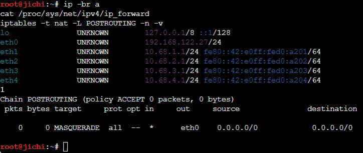

Verifikasi akses gateway dan internet dari host (contoh dari tengen):

```bash
ping -c 3 10.68.4.1
ping -c 3 google.com
```

**Nama file foto:** `images/soal1/ping-gateway-internet.png`

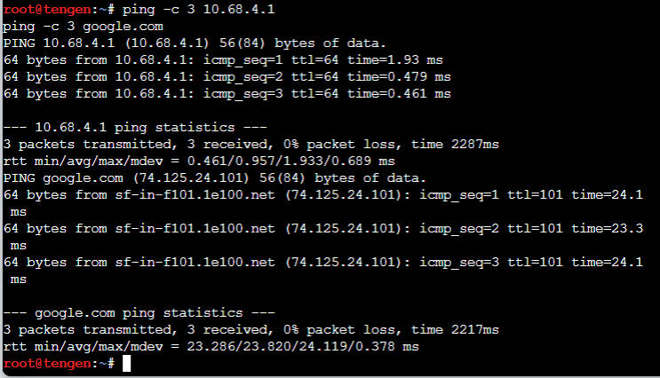

---

## 2. Konfigurasi DHCP Server pada tengen

tengen (`10.68.4.10`) dipasang `isc-dhcp-server` untuk mengelola distribusi IP dinamis.

Install paket:

```bash
apt update
apt install -y isc-dhcp-server
```

Konfigurasi `/etc/default/isc-dhcp-server`:

```text
INTERFACESv4="eth0"
INTERFACESv6=""
```

Pada `/etc/dhcp/dhcpd.conf`, Network 4 dideklarasikan sebagai subnet lokal tanpa pool alokasi dinamis untuk mencegah error `No subnet declaration for eth0`, kemudian scope awal Network 2 dan Network 3 disiapkan:

```text
option domain-name "k09.com";
option domain-name-servers 10.68.1.2, 10.68.1.3;
default-lease-time 600;
max-lease-time 7200;
ddns-update-style none;
authoritative;

# Subnet lokal Data Center tanpa pool dinamis
subnet 10.68.4.0 netmask 255.255.255.0 {
    option routers 10.68.4.1;
    option broadcast-address 10.68.4.255;
}

# Scope Network 2 (Divisi A)
subnet 10.68.2.0 netmask 255.255.255.0 {
    option routers 10.68.2.1;
    option broadcast-address 10.68.2.255;
    option domain-name-servers 10.68.1.2, 10.68.1.3;
    option domain-search "k09.com";
}

# Scope Network 3 (Divisi B)
subnet 10.68.3.0 netmask 255.255.255.0 {
    option routers 10.68.3.1;
    option broadcast-address 10.68.3.255;
    option domain-name-servers 10.68.1.2, 10.68.1.3;
    option domain-search "k09.com";
}
```

Validasi dan jalankan service:

```bash
dhcpd -t -cf /etc/dhcp/dhcpd.conf
service isc-dhcp-server restart
service isc-dhcp-server status
```

**Nama file foto:** `images/soal2/dhcpd-subnet.png`

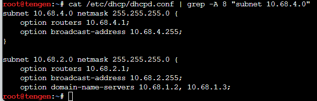

**Nama file foto:** `images/soal2/tengen-service-status.png`

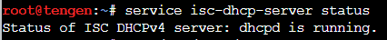

---

## 3. Konfigurasi DHCP Relay pada jichi

Paket broadcast DHCP dari Network 2 dan Network 3 diteruskan ke tengen menggunakan `isc-dhcp-relay` pada router jichi.

Install paket:

```bash
apt update
apt install -y isc-dhcp-relay
```

Konfigurasi `/etc/default/isc-dhcp-relay`:

```text
SERVERS="10.68.4.10"
INTERFACES="eth2 eth3"
OPTIONS=""
```

Jalankan dan periksa status service:

```bash
service isc-dhcp-relay restart
service isc-dhcp-relay status
```

**Nama file foto:** `images/soal3/relay-config.png`

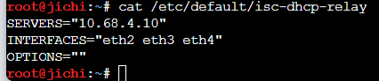

**Nama file foto:** `images/soal3/relay-status.png`

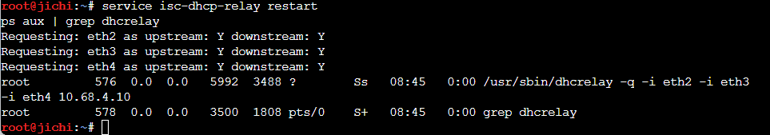

---

## 4. Segmentasi Dua Pool DHCP pada Network 2

Pada Network 2 (Divisi A), alamat dibagi menjadi dua pool berdasarkan tim:
* **Pool 1:** `10.68.2.10` – `10.68.2.35` untuk itadori dan fushiguro
* **Pool 2:** `10.68.2.70` – `10.68.2.95` untuk zenin dan okkotsu
* Rentang `10.68.2.36` – `10.68.2.69` sengaja tidak dialokasikan

Konfigurasi class dan pool pada `/etc/dhcp/dhcpd.conf` di tengen:

```text
class "pool1" {
    match if (option host-name = "itadori") or
             (substring(hardware, 1, 6) = 02:42:94:0f:6d:00) or
             (option host-name = "fushiguro") or
             (substring(hardware, 1, 6) = 02:42:d0:8b:5a:00);
}

class "pool2" {
    match if (option host-name = "zenin") or
             (substring(hardware, 1, 6) = 02:42:c5:24:d7:00) or
             (option host-name = "okkotsu") or
             (substring(hardware, 1, 6) = 02:42:fc:94:69:00);
}

subnet 10.68.2.0 netmask 255.255.255.0 {
    option routers 10.68.2.1;
    option broadcast-address 10.68.2.255;
    option domain-name-servers 10.68.1.2, 10.68.1.3;
    option domain-search "k09.com";

    pool {
        allow members of "pool1";
        range 10.68.2.10 10.68.2.35;
    }

    pool {
        allow members of "pool2";
        range 10.68.2.70 10.68.2.95;
    }
}
```

Eksekusi request dari klien (contoh itadori):

```sh
killall udhcpc 2>/dev/null
udhcpc -i eth0
```

Verifikasi alamat IP klien Pool 1 (itadori / fushiguro):

```bash
ip addr show eth0
```

**Nama file foto:** `images/soal4/pool1-itadori-fushiguro.png`

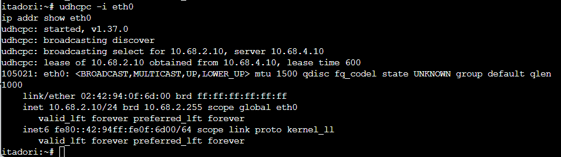

Verifikasi alamat IP klien Pool 2 (zenin / okkotsu):

```bash
ip addr show eth0
```

**Nama file foto:** `images/soal4/pool2-zenin-okkotsu.png`

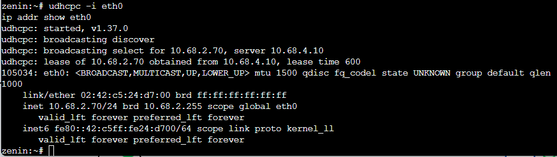

---

## 5. Pengaturan Lease Time dan Opsi DNS pada Network 3

Pada Network 3 (Divisi B), masa sewa alamat dibedakan berdasarkan mobilitas tim:
* **Short lease (30 menit / 1800 detik):** `10.68.3.10` – `10.68.3.89` untuk ino dan kusakabe
* **Long lease (12 jam / 43200 detik):** `10.68.3.100` – `10.68.3.199` untuk miwa
* Opsi DNS: `10.68.1.2`, `10.68.1.3` dan domain-search `k09.com`

Konfigurasi class dan subnet pada `/etc/dhcp/dhcpd.conf` di tengen:

```text
class "short-lease" {
    match if (option host-name = "ino") or
             (substring(hardware, 1, 6) = 02:42:ae:72:7a:00) or
             (option host-name = "kusakabe") or
             (substring(hardware, 1, 6) = 02:42:f0:3b:82:00);
}

class "long-lease" {
    match if (option host-name = "miwa") or
             (substring(hardware, 1, 6) = 02:42:eb:ee:d1:00);
}

subnet 10.68.3.0 netmask 255.255.255.0 {
    option routers 10.68.3.1;
    option broadcast-address 10.68.3.255;
    option domain-name-servers 10.68.1.2, 10.68.1.3;
    option domain-search "k09.com";

    pool {
        allow members of "short-lease";
        range 10.68.3.10 10.68.3.89;
        default-lease-time 1800;
        max-lease-time 1800;
    }

    pool {
        allow members of "long-lease";
        range 10.68.3.100 10.68.3.199;
        default-lease-time 43200;
        max-lease-time 43200;
    }
}
```

Eksekusi request dari klien Network 3:

Pada ino (short lease):
```sh
killall udhcpc 2>/dev/null
udhcpc -i eth0
```

**Nama file foto:** `images/soal5/ino-lease.png`

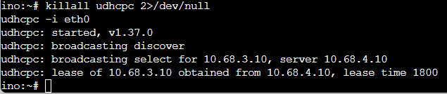

Pada miwa (long lease):
```sh
killall udhcpc 2>/dev/null
udhcpc -i eth0
```

**Nama file foto:** `images/soal5/miwa-lease.png`

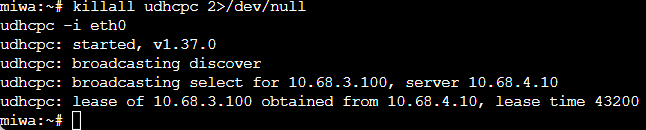

Verifikasi masa berlaku sewa pada `/var/lib/dhcp/dhcpd.leases` di tengen:

```bash
grep -E "lease|starts|ends|hardware" /var/lib/dhcp/dhcpd.leases
```

Hasil menunjukkan selisih waktu `starts` dan `ends` tepat 1800 detik (30 menit) untuk ino dan 43200 detik (12 jam) untuk miwa.

**Nama file foto:** `images/soal5/lease-database.png`


---

## 6. Static Lease VIP kugisaki

kugisaki ditetapkan sebagai VIP dengan IP tetap `10.68.3.99` yang berada di luar seluruh pool dinamis.

Cek MAC address pada kugisaki:

```bash
ip link show eth0 | grep ether
```

**Nama file foto:** `images/soal6/kugisaki-mac.png`

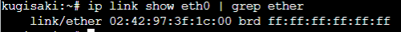

Tambahkan deklarasi host pada `/etc/dhcp/dhcpd.conf` di tengen:

```text
host kugisaki {
    hardware ethernet 02:42:97:3f:1c:00;
    fixed-address 10.68.3.99;
    option routers 10.68.3.1;
    option broadcast-address 10.68.3.255;
    option domain-name-servers 10.68.1.2, 10.68.1.3;
    option domain-search "k09.com";
}
```

Restart service DHCP server di tengen:

```bash
service isc-dhcp-server restart
```

Renew lease pada kugisaki:

```sh
killall udhcpc 2>/dev/null
udhcpc -i eth0
```

Verifikasi IP kugisaki:

```bash
ip addr show eth0
```

Hasil verifikasi menunjukkan kugisaki tepat menerima alamat `10.68.3.99`.

**Nama file foto:** `images/soal6/kugisaki-fixed-ip.png`

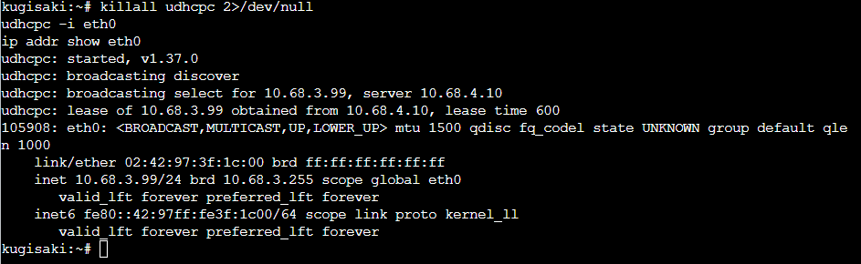

---

## 7. Verifikasi Seluruh Klien Divisi A dan B

Seluruh parameter jaringan klien diperiksa untuk memastikan subnet mask `/24`, default gateway, DNS server, dan domain search terpasang lengkap.

Verifikasi routing dan DNS pada salah satu klien (contoh itadori):

```bash
ip route show
cat /etc/resolv.conf
ping -c 2 10.68.2.1
```

**Nama file foto:** `images/soal7/client-routing-dns.png`

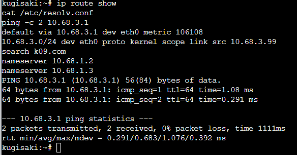

Verifikasi seluruh lease aktif pada tengen:

```bash
grep -E "^lease|client-hostname|binding state active" /var/lib/dhcp/dhcpd.leases
```

Hasil pemeriksaan memastikan seluruh alokasi IP sesuai kebijakan pool dan tidak ada alamat yang bertabrakan.

**Nama file foto:** `images/soal7/all-leases.png`

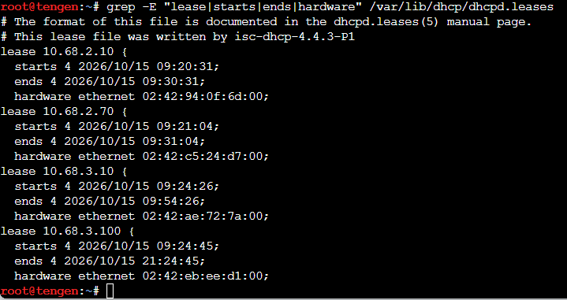

---

## 8. Analisis Transaksi DHCP Melalui Packet Capture

Pengujian dilakukan menggunakan klien `itadori` pada Network 2 (`10.68.2.0/24`). Itadori terhubung melalui interface `eth2` pada router `jichi`, sehingga field `giaddr` yang diharapkan pada paket yang diterima server adalah `10.68.2.1`.

Jalankan capture pada node `tengen` (`10.68.4.10`):

```bash
tcpdump -i eth0 -n -vvv 'port 67 or port 68'
```

Saat `tcpdump` menunggu paket, buka terminal `itadori` dan jalankan:

```sh
killall udhcpc 2>/dev/null
ip addr flush dev eth0
udhcpc -i eth0 -c itadori -H itadori
```

`-c itadori` mengirim Client ID (Option 61), sedangkan `-H itadori` mengirim hostname (Option 12). Hostname ini yang dicocokkan oleh class `pool1` pada konfigurasi DHCP server.

Jika transaksi berhasil, cari empat pesan berikut pada capture `tengen`:
1. `DHCPDISCOVER`: request yang diteruskan relay; field `Gateway-IP`/`giaddr` diharapkan bernilai `10.68.2.1`.
2. `DHCPOFFER`: server `tengen` (`10.68.4.10`) menawarkan alamat klien dari Pool 1, yaitu rentang `10.68.2.10`–`10.68.2.35`.
3. `DHCPREQUEST`: klien meminta alamat yang ditawarkan; field `giaddr` tetap `10.68.2.1`.
4. `DHCPACK`: server mengonfirmasi lease untuk alamat yang ditawarkan. IP tepatnya bisa berbeda selama masih berada dalam rentang Pool 1 dan tersedia.

Field `giaddr` adalah alamat interface relay yang menerima request dari subnet klien. Karena `itadori` berada di Network 2 yang terhubung ke `eth2` `jichi`, nilainya harus `10.68.2.1`. Jangan gunakan `kugisaki` untuk pengujian ini karena ia berada di Network 3 dan akan menghasilkan `giaddr` `10.68.3.1`.

**Nama file foto:** `images/soal8/tcpdump-dora-giaddr.png`

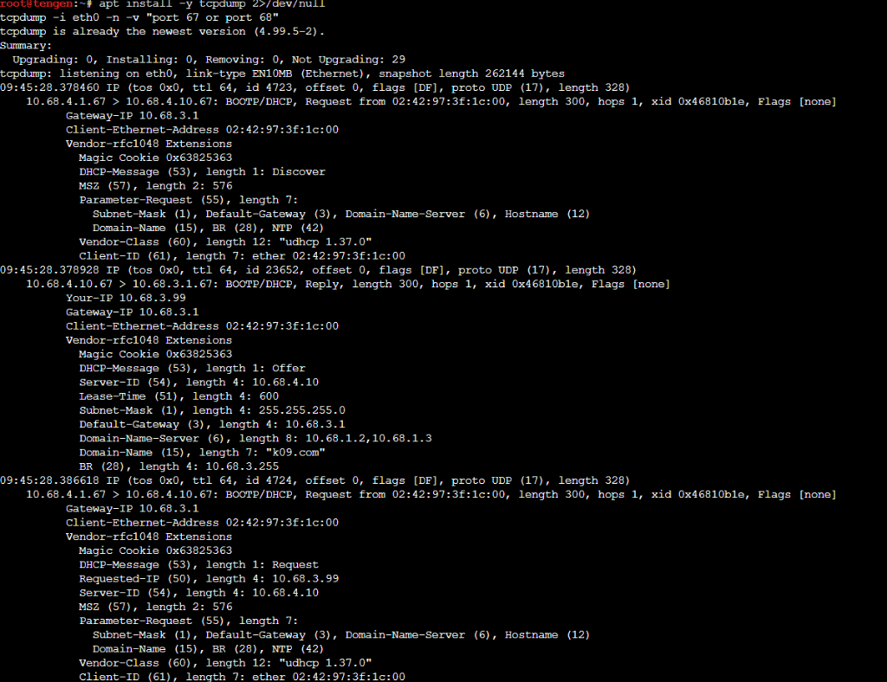

**Nama file foto:** `images/soal8/tcpdump-ack.png`

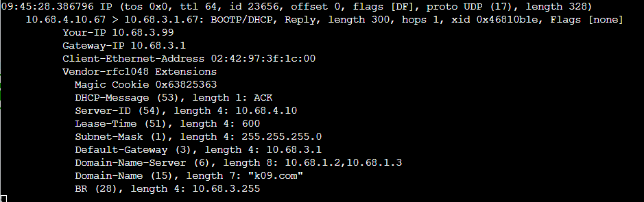

Setelah capture, verifikasi bahwa alamat `itadori` berada di Pool 1:

```bash
ip addr show eth0
```

---

## 9. Pengujian Gangguan DHCP Relay dan Pemulihan

Uji ketahanan sistem dilakukan dengan mematikan service relay pada router jichi.

Hentikan DHCP Relay di jichi:

```bash
service isc-dhcp-relay stop
service isc-dhcp-relay status
```

Klien (contoh kugisaki) dipaksa meminta lease baru:

```sh
killall udhcpc 2>/dev/null
ip addr flush dev eth0
udhcpc -i eth0 -t 3 -T 2
```

Klien mengalami timeout dan tidak memperoleh IP karena paket discover tidak diteruskan ke tengen.

**Nama file foto:** `images/soal9/relay-down-timeout.png`

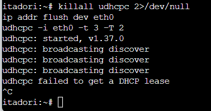

Layanan relay dinyalakan kembali di jichi:

```bash
service isc-dhcp-relay start
service isc-dhcp-relay status
```

Klien meminta ulang lease dan kembali berhasil memperoleh IP dari pool semula:

```sh
udhcpc -i eth0
ip addr show eth0
```

**Nama file foto:** `images/soal9/relay-recovered.png`

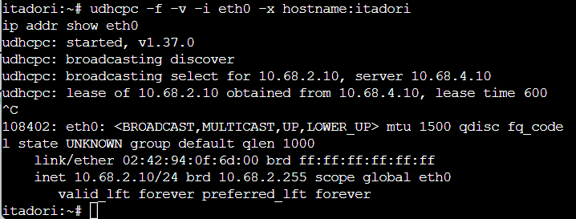

---

## 10. Autostart Service dan Persistensi Pasca Reboot

Seluruh konfigurasi jaringan, forwarding, iptables NAT, dan service dibuat persisten agar tetap aktif setelah node direstart.

Pada jichi:
* Konfigurasi interface `eth0`–`eth4` pada `/etc/network/interfaces`
* `net.ipv4.ip_forward = 1` pada `/etc/sysctl.conf`
* Aturan NAT dan startup relay pada `/etc/rc.local`
* Autostart service via `update-rc.d isc-dhcp-relay defaults`

Pada tengen:
* Konfigurasi IP statis `10.68.4.10` dan gateway `10.68.4.1` pada `/etc/network/interfaces`
* Autostart service via `update-rc.d isc-dhcp-server defaults`

Setelah dilakukan restart node di GNS3, status jichi diperiksa:

```bash
service isc-dhcp-relay status
ip -br a
cat /proc/sys/net/ipv4/ip_forward
iptables -t nat -L -v -n
```

**Nama file foto:** `images/soal10/jichi-autostart.png`

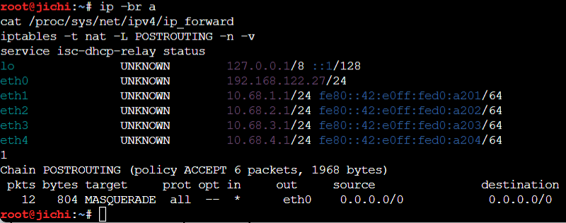

Status tengen setelah restart:

```bash
service isc-dhcp-server status
ip addr show eth0
```

**Nama file foto:** `images/soal10/tengen-autostart.png`

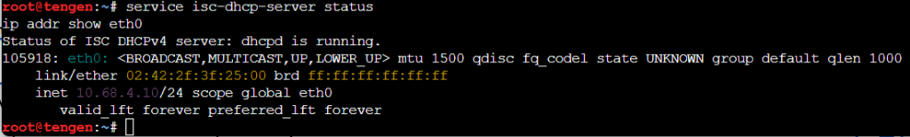

Verifikasi dari klien (contoh kugisaki):

```sh
udhcpc -i eth0
ip addr show eth0
```

Klien tetap memperoleh lease yang valid sesuai kebijakan alokasi semula.

**Nama file foto:** `images/soal10/client-renew.png`

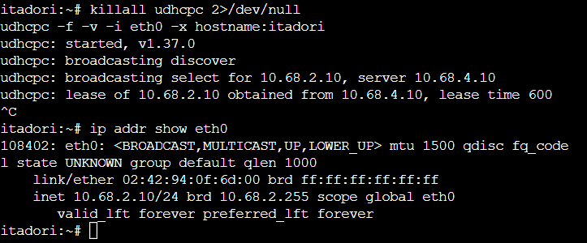
