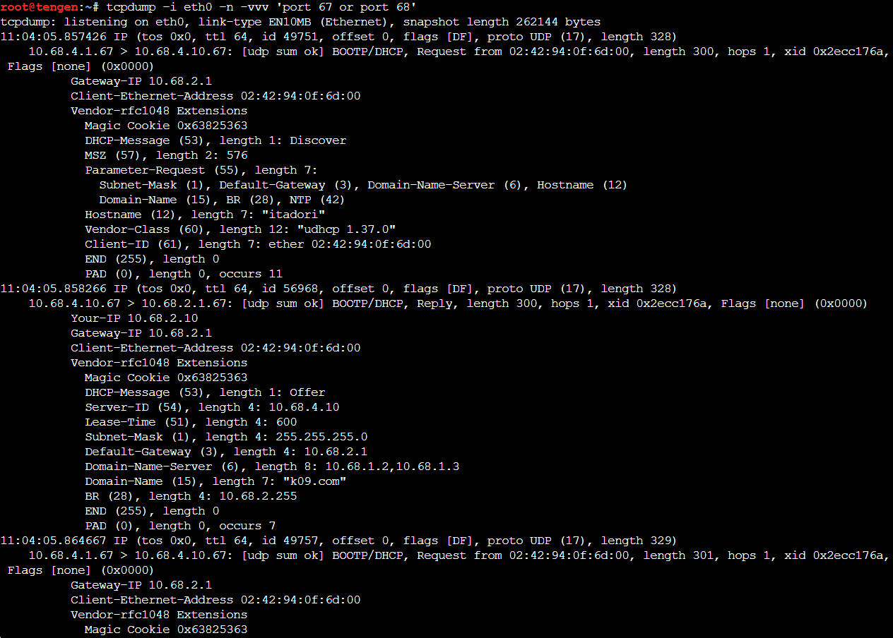
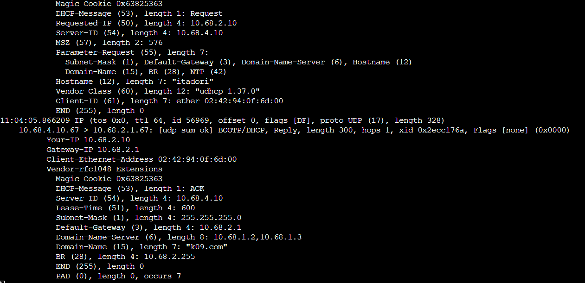
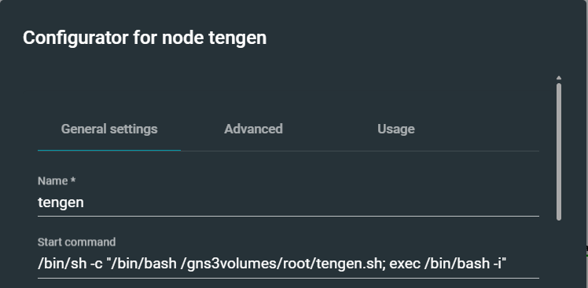
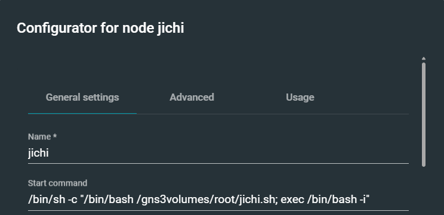

# Jarkom Modul 3 2026 K-09

| Nama | NRP |
| :--- | :--- |
| Sultan Ahmad Maulana Bahyshidqi | 5027251070 |
| Muhammad Razzan Azizi Djauhari | 5027251086 |

Dokumentasi pengerjaan Praktikum Modul 3 Komunikasi Data & Jaringan Komputer menggunakan GNS3 dengan prefix jaringan `10.68.x.x` dan domain internal `k09.com`.

---

## 1. Konfigurasi Topologi dan IP Address

jichi berfungsi sebagai router sentral yang terhubung ke NAT serta empat jaringan internal.

**Nama file foto:** `images/soal1/topologi.png`


### Skema interface jichi

| Interface | Jaringan | Node |
| :--- | :--- | :--- |
| `eth0` | NAT / WAN | Internet |
| `eth1` | `10.68.1.0/24` (DMZ) | utahime, shoko, gojo |
| `eth2` | `10.68.2.0/24` (Divisi A) | itadori, fushiguro, zenin, okkotsu |
| `eth3` | `10.68.3.0/24` (Divisi B) | ino, kusakabe, miwa, kugisaki |
| `eth4` | `10.68.4.0/24` (Data Center) | tengen, geto, maki, panda, nanami, todo, kirara, yaga, inumaki |

Konfigurasi `/etc/network/interfaces` pada jichi:

```text
auto eth0
iface eth0 inet dhcp
    up sysctl -w net.ipv4.ip_forward=1
    up iptables -t nat -C POSTROUTING -s 10.68.0.0/16 -o eth0 -j MASQUERADE 2>/dev/null || iptables -t nat -A POSTROUTING -s 10.68.0.0/16 -o eth0 -j MASQUERADE

auto eth1
iface eth1 inet static
    address 10.68.1.1
    netmask 255.255.255.0

auto eth2
iface eth2 inet static
    address 10.68.2.1
    netmask 255.255.255.0

auto eth3
iface eth3 inet static
    address 10.68.3.1
    netmask 255.255.255.0

auto eth4
iface eth4 inet static
    address 10.68.4.1
    netmask 255.255.255.0
```

### Pengalamatan host infrastruktur

| Node | Peran | IP Address | Gateway |
| :--- | :--- | :--- | :--- |
| utahime | DNS Master | `10.68.1.2/24` | `10.68.1.1` |
| shoko | DNS Slave | `10.68.1.3/24` | `10.68.1.1` |
| gojo | Reverse Proxy | `10.68.1.4/24` | `10.68.1.1` |
| tengen | DHCP Server | `10.68.4.10/24` | `10.68.4.1` |
| geto | Load Balancer | `10.68.4.2/24` | `10.68.4.1` |
| maki | Web Frontend | `10.68.4.3/24` | `10.68.4.1` |
| panda | Web Frontend | `10.68.4.4/24` | `10.68.4.1` |
| nanami | Worker API Utama | `10.68.4.5/24` | `10.68.4.1` |
| todo | Worker API Utama | `10.68.4.6/24` | `10.68.4.1` |
| kirara | Worker API Cadangan | `10.68.4.7/24` | `10.68.4.1` |
| yaga | Database Master | `10.68.4.8/24` | `10.68.4.1` |
| inumaki | Database Slave | `10.68.4.9/24` | `10.68.4.1` |

Contoh konfigurasi interface host tengen (`/etc/network/interfaces`):

```text
auto eth0
iface eth0 inet static
    address 10.68.4.10
    netmask 255.255.255.0
    gateway 10.68.4.1
    up echo "nameserver 192.168.122.1" > /etc/resolv.conf
```

Verifikasi konfigurasi dan NAT pada jichi:

```bash
ip -br a
cat /proc/sys/net/ipv4/ip_forward
iptables -t nat -L POSTROUTING -n -v
```

**Nama file foto:** `images/soal1/jichi-ip-nat.png`


Verifikasi akses gateway dan internet dari host (contoh dari tengen):

```bash
ping -c 3 10.68.4.1
ping -c 3 google.com
```

**Nama file foto:** `images/soal1/ping-gateway-internet.png`


---

## 2. Konfigurasi DHCP Server pada tengen

tengen (`10.68.4.10`) dipasang `isc-dhcp-server` untuk mengelola distribusi IP dinamis.

Install paket:

```bash
apt update
apt install -y isc-dhcp-server
```

Konfigurasi `/etc/default/isc-dhcp-server`:

```text
INTERFACESv4="eth0"
INTERFACESv6=""
```

Pada `/etc/dhcp/dhcpd.conf`, Network 4 dideklarasikan sebagai subnet lokal tanpa pool alokasi dinamis untuk mencegah error `No subnet declaration for eth0`, kemudian scope awal Network 2 dan Network 3 disiapkan:

```text
option domain-name "k09.com";
option domain-name-servers 10.68.1.2, 10.68.1.3;
default-lease-time 600;
max-lease-time 7200;
ddns-update-style none;
authoritative;

# Subnet lokal Data Center tanpa pool dinamis
subnet 10.68.4.0 netmask 255.255.255.0 {
    option routers 10.68.4.1;
    option broadcast-address 10.68.4.255;
}

# Scope Network 2 (Divisi A)
subnet 10.68.2.0 netmask 255.255.255.0 {
    option routers 10.68.2.1;
    option broadcast-address 10.68.2.255;
    option domain-name-servers 10.68.1.2, 10.68.1.3;
    option domain-search "k09.com";
}

# Scope Network 3 (Divisi B)
subnet 10.68.3.0 netmask 255.255.255.0 {
    option routers 10.68.3.1;
    option broadcast-address 10.68.3.255;
    option domain-name-servers 10.68.1.2, 10.68.1.3;
    option domain-search "k09.com";
}
```

Validasi dan jalankan service:

```bash
dhcpd -t -cf /etc/dhcp/dhcpd.conf
service isc-dhcp-server restart
service isc-dhcp-server status
```

**Nama file foto:** `images/soal2/dhcpd-subnet.png`


**Nama file foto:** `images/soal2/tengen-service-status.png`


---

## 3. Konfigurasi DHCP Relay pada jichi

Paket broadcast DHCP dari Network 2 dan Network 3 diteruskan ke tengen menggunakan `isc-dhcp-relay` pada router jichi.

Install paket:

```bash
apt update
apt install -y isc-dhcp-relay
```

Konfigurasi `/etc/default/isc-dhcp-relay`:

```text
SERVERS="10.68.4.10"
INTERFACES="eth2 eth3"
OPTIONS=""
```

Jalankan dan periksa status service:

```bash
service isc-dhcp-relay restart
service isc-dhcp-relay status
```

**Nama file foto:** `images/soal3/relay-config.png`


**Nama file foto:** `images/soal3/relay-status.png`


---

## 4. Segmentasi Dua Pool DHCP pada Network 2

Pada Network 2 (Divisi A), alamat dibagi menjadi dua pool berdasarkan tim:
* **Pool 1:** `10.68.2.10` – `10.68.2.35` untuk itadori dan fushiguro
* **Pool 2:** `10.68.2.70` – `10.68.2.95` untuk zenin dan okkotsu
* Rentang `10.68.2.36` – `10.68.2.69` sengaja tidak dialokasikan

Konfigurasi class dan pool pada `/etc/dhcp/dhcpd.conf` di tengen:

```text
class "pool1" {
    match if (option host-name = "itadori") or
             (substring(hardware, 1, 6) = 02:42:94:0f:6d:00) or
             (option host-name = "fushiguro") or
             (substring(hardware, 1, 6) = 02:42:d0:8b:5a:00);
}

class "pool2" {
    match if (option host-name = "zenin") or
             (substring(hardware, 1, 6) = 02:42:c5:24:d7:00) or
             (option host-name = "okkotsu") or
             (substring(hardware, 1, 6) = 02:42:fc:94:69:00);
}

subnet 10.68.2.0 netmask 255.255.255.0 {
    option routers 10.68.2.1;
    option broadcast-address 10.68.2.255;
    option domain-name-servers 10.68.1.2, 10.68.1.3;
    option domain-search "k09.com";

    pool {
        allow members of "pool1";
        range 10.68.2.10 10.68.2.35;
    }

    pool {
        allow members of "pool2";
        range 10.68.2.70 10.68.2.95;
    }
}
```

Eksekusi request dari klien (contoh itadori):

```sh
killall udhcpc 2>/dev/null
udhcpc -i eth0
```

Verifikasi alamat IP klien Pool 1 (itadori / fushiguro):

```bash
ip addr show eth0
```

**Nama file foto:** `images/soal4/pool1-itadori-fushiguro.png`


Verifikasi alamat IP klien Pool 2 (zenin / okkotsu):

```bash
ip addr show eth0
```

**Nama file foto:** `images/soal4/pool2-zenin-okkotsu.png`


---

## 5. Pengaturan Lease Time dan Opsi DNS pada Network 3

Pada Network 3 (Divisi B), masa sewa alamat dibedakan berdasarkan mobilitas tim:
* **Short lease (30 menit / 1800 detik):** `10.68.3.10` – `10.68.3.89` untuk ino dan kusakabe
* **Long lease (12 jam / 43200 detik):** `10.68.3.100` – `10.68.3.199` untuk miwa
* Opsi DNS: `10.68.1.2`, `10.68.1.3` dan domain-search `k09.com`

Konfigurasi class dan subnet pada `/etc/dhcp/dhcpd.conf` di tengen:

```text
class "short-lease" {
    match if (option host-name = "ino") or
             (substring(hardware, 1, 6) = 02:42:ae:72:7a:00) or
             (option host-name = "kusakabe") or
             (substring(hardware, 1, 6) = 02:42:f0:3b:82:00);
}

class "long-lease" {
    match if (option host-name = "miwa") or
             (substring(hardware, 1, 6) = 02:42:eb:ee:d1:00);
}

subnet 10.68.3.0 netmask 255.255.255.0 {
    option routers 10.68.3.1;
    option broadcast-address 10.68.3.255;
    option domain-name-servers 10.68.1.2, 10.68.1.3;
    option domain-search "k09.com";

    pool {
        allow members of "short-lease";
        range 10.68.3.10 10.68.3.89;
        default-lease-time 1800;
        max-lease-time 1800;
    }

    pool {
        allow members of "long-lease";
        range 10.68.3.100 10.68.3.199;
        default-lease-time 43200;
        max-lease-time 43200;
    }
}
```

Eksekusi request dari klien Network 3:

Pada ino (short lease):
```sh
killall udhcpc 2>/dev/null
udhcpc -i eth0
```

**Nama file foto:** `images/soal5/ino-lease.png`


Pada miwa (long lease):
```sh
killall udhcpc 2>/dev/null
udhcpc -i eth0
```

**Nama file foto:** `images/soal5/miwa-lease.png`


Verifikasi masa berlaku sewa pada `/var/lib/dhcp/dhcpd.leases` di tengen:

```bash
grep -E "lease|starts|ends|hardware" /var/lib/dhcp/dhcpd.leases
```

Hasil menunjukkan selisih waktu `starts` dan `ends` tepat 1800 detik (30 menit) untuk ino dan 43200 detik (12 jam) untuk miwa.

**Nama file foto:** `images/soal5/lease-database.png`


---

## 6. Static Lease VIP kugisaki

kugisaki ditetapkan sebagai VIP dengan IP tetap `10.68.3.99` yang berada di luar seluruh pool dinamis.

Cek MAC address pada kugisaki:

```bash
ip link show eth0 | grep ether
```

**Nama file foto:** `images/soal6/kugisaki-mac.png`


Tambahkan deklarasi host pada `/etc/dhcp/dhcpd.conf` di tengen:

```text
host kugisaki {
    hardware ethernet 02:42:97:3f:1c:00;
    fixed-address 10.68.3.99;
    option routers 10.68.3.1;
    option broadcast-address 10.68.3.255;
    option domain-name-servers 10.68.1.2, 10.68.1.3;
    option domain-search "k09.com";
}
```

Restart service DHCP server di tengen:

```bash
service isc-dhcp-server restart
```

Renew lease pada kugisaki:

```sh
killall udhcpc 2>/dev/null
udhcpc -i eth0
```

Verifikasi IP kugisaki:

```bash
ip addr show eth0
```

Hasil verifikasi menunjukkan kugisaki tepat menerima alamat `10.68.3.99`.

**Nama file foto:** `images/soal6/kugisaki-fixed-ip.png`


---

## 7. Verifikasi Seluruh Klien Divisi A dan B

Seluruh parameter jaringan klien diperiksa untuk memastikan subnet mask `/24`, default gateway, DNS server, dan domain search terpasang lengkap.

Verifikasi routing dan DNS pada salah satu klien (contoh itadori):

```bash
ip route show
cat /etc/resolv.conf
ping -c 2 10.68.2.1
```

**Nama file foto:** `images/soal7/client-routing-dns.png`


Verifikasi seluruh lease aktif pada tengen:

```bash
grep -E "^lease|client-hostname|binding state active" /var/lib/dhcp/dhcpd.leases
```

Hasil pemeriksaan memastikan seluruh alokasi IP sesuai kebijakan pool dan tidak ada alamat yang bertabrakan.

**Nama file foto:** `images/soal7/all-leases.png`


---

## 8. Analisis Transaksi DHCP Melalui Packet Capture

Pengujian aktual dilakukan dari klien `itadori` di Network 2 (`10.68.2.0/24`) dengan DHCP server `tengen` (`10.68.4.10`). Capture dijalankan pada `eth0` tengen, sementara `itadori` meminta lease baru menggunakan hostname DHCP `itadori`.

### Perintah pengujian

Pada `tengen`:
```bash
tcpdump -i eth0 -n -vvv 'port 67 or port 68'
```

Pada `itadori` (BusyBox `udhcpc`):
```sh
killall udhcpc 2>/dev/null
ip addr flush dev eth0
udhcpc -f -v -i eth0 -x hostname:itadori
```

Opsi `-x hostname:itadori` mengirim DHCP Host Name (Option 12), yang cocok dengan class `pool1` pada konfigurasi DHCP server.

### Hasil capture yang berhasil

Capture menunjukkan keempat tahap DORA. Nilai yang terbaca pada output adalah:

| Tahap | Bukti pada capture |
| :--- | :--- |
| DHCPDISCOVER | Paket diteruskan dari relay `10.68.4.1` ke server `10.68.4.10`; `Gateway-IP`/`giaddr` = `10.68.2.1`; hostname = `itadori`. |
| DHCPOFFER | Server `10.68.4.10` menawarkan `10.68.2.10`; `giaddr` = `10.68.2.1`; lease time = `600` detik. |
| DHCPREQUEST | Klien meminta kembali `10.68.2.10` dan mencantumkan Server Identifier `10.68.4.10`; `giaddr` = `10.68.2.1`. |
| DHCPACK | Server mengonfirmasi lease `10.68.2.10`; `giaddr` = `10.68.2.1`; lease time = `600` detik. |

MAC klien yang terlihat pada capture adalah `02:42:94:0f:6d:00`. Alamat yang ditawarkan (`10.68.2.10`) berada di rentang Pool 1 (`10.68.2.10`–`10.68.2.35`). Dengan demikian, pengujian membuktikan bahwa relay meneruskan request dari Network 2 dengan `giaddr` yang benar dan server menyelesaikan transaksi DORA.

**Catatan lease time:** capture menunjukkan `600` detik (10 menit). Nilai ini sesuai dengan `default-lease-time 600` global pada `dhcpd.conf`; pool Network 2 tidak menetapkan lease time khusus. Pengaturan lease 1800 dan 43200 detik yang dibahas pada Soal 5 berlaku untuk class di Network 3.

Field `Gateway-IP` yang ditampilkan `tcpdump` adalah nilai `giaddr`. Karena `itadori` berada di Network 2 yang terhubung ke interface `eth2` jichi, nilainya harus `10.68.2.1`. Jika pengujian dilakukan dari `kugisaki` di Network 3, nilai yang diharapkan berbeda, yaitu `10.68.3.1`.

**Nama file foto:** `images/soal8/tcpdump-dora-part1.png`



**Nama file foto:** `images/soal8/tcpdump-dora-part2.png`



Verifikasi akhir pada `itadori`:

```bash
ip addr show eth0
ip route show
```

Alamat yang diharapkan pada hasil uji ini adalah `10.68.2.10/24` dengan gateway `10.68.2.1`.

---

## 9. Pengujian Gangguan DHCP Relay dan Pemulihan

Pengujian dilakukan menggunakan klien `itadori` di Network 2. Itadori dipilih karena mendapatkan IP secara dinamis dari Pool 1 (`10.68.2.10`–`10.68.2.35`), sehingga pengujian ini benar-benar memeriksa proses permintaan lease DHCP. Berbeda dengan `kugisaki`, yang menggunakan static lease.

### Fase 1 — Matikan DHCP Relay pada jichi

Jalankan pada node `jichi`:

```bash
service isc-dhcp-relay stop
service isc-dhcp-relay status
```

Pastikan status service menunjukkan bahwa relay berhenti.

### Fase 2 — Buktikan permintaan lease gagal pada itadori

Jalankan pada node `itadori`:

```sh
killall udhcpc 2>/dev/null
ip addr flush dev eth0
udhcpc -i eth0 -t 3 -T 2
```

Saat relay berhenti, permintaan DHCPDISCOVER dari itadori tidak diteruskan ke server `tengen`. Output seharusnya menunjukkan beberapa percobaan `sending discover` yang berakhir dengan timeout, dan itadori tidak memperoleh alamat IP.

**Nama file foto:** `images/soal9/relay-down-timeout.png`


### Fase 3 — Pulihkan DHCP Relay pada jichi

Jalankan kembali pada node `jichi`:

```bash
service isc-dhcp-relay start
service isc-dhcp-relay status
```

Pastikan service relay kembali aktif sebelum klien mencoba meminta IP lagi.

### Fase 4 — Minta lease kembali dari itadori

Jalankan pada node `itadori`:

```sh
udhcpc -f -v -i eth0 -x hostname:itadori
ip addr show eth0
```

Opsi `-x hostname:itadori` mengirim hostname DHCP (Option 12) dan digunakan karena BusyBox `udhcpc` pada node ini tidak mengenali opsi `-H`. Setelah relay aktif, itadori seharusnya kembali memperoleh alamat IP dinamis dari Pool 1, yaitu rentang `10.68.2.10`–`10.68.2.35`. Catat alamat yang benar-benar muncul pada hasil pengujian.

**Nama file foto:** `images/soal9/relay-recovered.png`


Pengujian ini menunjukkan bahwa ketika DHCP Relay pada jichi berhenti, permintaan DHCP dari Network 2 tidak dapat mencapai tengen sehingga klien mengalami timeout. Setelah relay dijalankan kembali, permintaan dapat diteruskan dan itadori kembali memperoleh lease dari pool yang sesuai.

---

## 10. Autostart Service dan Persistensi Pasca Reboot

Pada node Docker di GNS3, paket dan perubahan yang dibuat di dalam filesystem container tidak selalu bertahan ketika node di-reset atau dibuat ulang. Karena itu, `systemctl enable` atau `update-rc.d` saja tidak cukup untuk memastikan DHCP Server dan DHCP Relay siap setelah node dijalankan kembali.

Solusi yang digunakan pada praktikum ini adalah mengatur **Start command** di konfigurasi node GNS3 agar script dari volume `/gns3volumes/root/` dijalankan setiap kali node mulai. Script tersebut memasang paket yang diperlukan, menulis ulang konfigurasi, lalu me-restart service. Dengan cara ini, layanan disiapkan kembali saat startup jika paket atau konfigurasi di dalam container hilang.

### Start command pada tengen

Buka **Configure → Start command** pada node `tengen`, lalu isi dengan:

```bash
/bin/sh -c "/bin/bash /gns3volumes/root/tengen.sh; exec /bin/bash -i"
```

Script `/gns3volumes/root/tengen.sh` mengatur IP statis `10.68.4.10/24`, memasang `isc-dhcp-server`, menulis konfigurasi DHCP untuk Soal 2, 4, 5, dan 6, kemudian menjalankan ulang service. Bagian `exec /bin/bash -i` menjaga shell container tetap berjalan setelah script selesai.

**Nama file foto:** `images/soal10/tengen-start-command.png`



Setelah menyimpan Start command, lakukan stop lalu start pada node `tengen`. Verifikasi paket, status service, dan IP:

```bash
dpkg -s isc-dhcp-server | grep Status
service isc-dhcp-server status
ip addr show eth0
```

**Nama file foto:** `images/soal10/tengen-autostart.png`


### Start command pada jichi

Buka **Configure → Start command** pada node `jichi`, lalu isi dengan:

```bash
/bin/sh -c "/bin/bash /gns3volumes/root/jichi.sh; exec /bin/bash -i"
```

Script `/gns3volumes/root/jichi.sh` mengatur interface router, mengaktifkan IPv4 forwarding dan NAT, memasang `isc-dhcp-relay`, lalu menulis konfigurasi relay. Interface relay tetap menggunakan `eth2 eth3 eth4` dan server DHCP tetap `10.68.4.10`.

**Nama file foto:** `images/soal10/jichi-start-command.png`



Setelah menyimpan Start command, lakukan stop lalu start pada node `jichi`. Verifikasi paket, konfigurasi, dan proses relay:

```bash
dpkg -s isc-dhcp-relay | grep Status
cat /etc/default/isc-dhcp-relay
service isc-dhcp-relay status
ps aux | grep '[d]hcrelay'
ip -br a
cat /proc/sys/net/ipv4/ip_forward
iptables -t nat -L POSTROUTING -n -v
```

Konfigurasi relay yang diharapkan mencakup:

```text
SERVERS="10.68.4.10"
INTERFACES="eth2 eth3 eth4"
OPTIONS=""
```

Proses `dhcrelay` harus muncul setelah node dimulai. Jika service belum aktif, periksa output script dan status service sebelum menguji client.

**Nama file foto:** `images/soal10/jichi-autostart.png`


### Verifikasi lease dari klien

Setelah `tengen` dan `jichi` aktif, jalankan pada node `itadori`:

```sh
killall udhcpc 2>/dev/null
udhcpc -f -v -i eth0 -x hostname:itadori
```

Jika berhasil, output menampilkan lease yang diperoleh dari server `10.68.4.10`, misalnya `10.68.2.10` yang termasuk Pool 1. Setelah lease didapat, tekan `Ctrl+C`, lalu verifikasi alamatnya:

```bash
ip addr show eth0
```

**Nama file foto:** `images/soal10/client-renew.png`


**Catatan:** pendekatan ini menjalankan ulang script saat node mulai, bukan memasukkan paket ke dalam Docker image secara permanen. Script melakukan `apt-get update` dan memasang paket yang dibutuhkan, sehingga proses startup memerlukan akses ke repositori paket. Jika nantinya tersedia akses untuk membuat custom Docker image pada server GNS3 kampus, paket dapat dipasang langsung ke image agar tidak perlu diinstal ulang setiap kali startup.
