# Jarkom Modul 3 2026 K-09

| Nama | NRP |
| :--- | :--- |
| Sultan Ahmad Maulana Bahyshidqi | 5027251070 |
| Muhammad Razzan Azizi Djauhari | 5027251086 |

Dokumentasi pengerjaan Praktikum Modul 3 Komunikasi Data & Jaringan Komputer menggunakan GNS3 dengan prefix jaringan `10.68.x.x` dan domain internal `k09.com`.

---

## 1. Konfigurasi Topologi dan IP Address

jichi berfungsi sebagai router sentral yang terhubung ke NAT serta empat jaringan internal.

**Nama file foto:** `images/soal1/topologi.png`


### Skema interface jichi

| Interface | Jaringan | Node |
| :--- | :--- | :--- |
| `eth0` | NAT / WAN | Internet |
| `eth1` | `10.68.1.0/24` (DMZ) | utahime, shoko, gojo |
| `eth2` | `10.68.2.0/24` (Divisi A) | itadori, fushiguro, zenin, okkotsu |
| `eth3` | `10.68.3.0/24` (Divisi B) | ino, kusakabe, miwa, kugisaki |
| `eth4` | `10.68.4.0/24` (Data Center) | tengen, geto, maki, panda, nanami, todo, kirara, yaga, inumaki |

Konfigurasi `/etc/network/interfaces` pada jichi:

```text
auto eth0
iface eth0 inet dhcp
    up sysctl -w net.ipv4.ip_forward=1
    up iptables -t nat -C POSTROUTING -s 10.68.0.0/16 -o eth0 -j MASQUERADE 2>/dev/null || iptables -t nat -A POSTROUTING -s 10.68.0.0/16 -o eth0 -j MASQUERADE

auto eth1
iface eth1 inet static
    address 10.68.1.1
    netmask 255.255.255.0

auto eth2
iface eth2 inet static
    address 10.68.2.1
    netmask 255.255.255.0

auto eth3
iface eth3 inet static
    address 10.68.3.1
    netmask 255.255.255.0

auto eth4
iface eth4 inet static
    address 10.68.4.1
    netmask 255.255.255.0
```

### Pengalamatan host infrastruktur

| Node | Peran | IP Address | Gateway |
| :--- | :--- | :--- | :--- |
| utahime | DNS Master | `10.68.1.2/24` | `10.68.1.1` |
| shoko | DNS Slave | `10.68.1.3/24` | `10.68.1.1` |
| gojo | Reverse Proxy | `10.68.1.4/24` | `10.68.1.1` |
| tengen | DHCP Server | `10.68.4.10/24` | `10.68.4.1` |
| geto | Load Balancer | `10.68.4.2/24` | `10.68.4.1` |
| maki | Web Frontend | `10.68.4.3/24` | `10.68.4.1` |
| panda | Web Frontend | `10.68.4.4/24` | `10.68.4.1` |
| nanami | Worker API Utama | `10.68.4.5/24` | `10.68.4.1` |
| todo | Worker API Utama | `10.68.4.6/24` | `10.68.4.1` |
| kirara | Worker API Cadangan | `10.68.4.7/24` | `10.68.4.1` |
| yaga | Database Master | `10.68.4.8/24` | `10.68.4.1` |
| inumaki | Database Slave | `10.68.4.9/24` | `10.68.4.1` |

Contoh konfigurasi interface host tengen (`/etc/network/interfaces`):

```text
auto eth0
iface eth0 inet static
    address 10.68.4.10
    netmask 255.255.255.0
    gateway 10.68.4.1
    up echo "nameserver 192.168.122.1" > /etc/resolv.conf
```

Verifikasi konfigurasi dan NAT pada jichi:

```bash
ip -br a
cat /proc/sys/net/ipv4/ip_forward
iptables -t nat -L POSTROUTING -n -v
```

**Nama file foto:** `images/soal1/jichi-ip-nat.png`


Verifikasi akses gateway dan internet dari host (contoh dari tengen):

```bash
ping -c 3 10.68.4.1
ping -c 3 google.com
```

**Nama file foto:** `images/soal1/ping-gateway-internet.png`


---

## 2. Konfigurasi DHCP Server pada tengen

tengen (`10.68.4.10`) dipasang `isc-dhcp-server` untuk mengelola distribusi IP dinamis.

Install paket:

```bash
apt update
apt install -y isc-dhcp-server
```

Konfigurasi `/etc/default/isc-dhcp-server`:

```text
INTERFACESv4="eth0"
INTERFACESv6=""
```

Pada `/etc/dhcp/dhcpd.conf`, Network 4 dideklarasikan sebagai subnet lokal tanpa pool alokasi dinamis untuk mencegah error `No subnet declaration for eth0`, kemudian scope awal Network 2 dan Network 3 disiapkan:

```text
option domain-name "k09.com";
option domain-name-servers 10.68.1.2, 10.68.1.3;
default-lease-time 600;
max-lease-time 7200;
ddns-update-style none;
authoritative;

# Subnet lokal Data Center tanpa pool dinamis
subnet 10.68.4.0 netmask 255.255.255.0 {
    option routers 10.68.4.1;
    option broadcast-address 10.68.4.255;
}

# Scope Network 2 (Divisi A)
subnet 10.68.2.0 netmask 255.255.255.0 {
    option routers 10.68.2.1;
    option broadcast-address 10.68.2.255;
    option domain-name-servers 10.68.1.2, 10.68.1.3;
    option domain-search "k09.com";
}

# Scope Network 3 (Divisi B)
subnet 10.68.3.0 netmask 255.255.255.0 {
    option routers 10.68.3.1;
    option broadcast-address 10.68.3.255;
    option domain-name-servers 10.68.1.2, 10.68.1.3;
    option domain-search "k09.com";
}
```

Validasi dan jalankan service:

```bash
dhcpd -t -cf /etc/dhcp/dhcpd.conf
service isc-dhcp-server restart
service isc-dhcp-server status
```

**Nama file foto:** `images/soal2/dhcpd-subnet.png`


**Nama file foto:** `images/soal2/tengen-service-status.png`


---

## 3. Konfigurasi DHCP Relay pada jichi

Paket broadcast DHCP dari Network 2 dan Network 3 diteruskan ke tengen menggunakan `isc-dhcp-relay` pada router jichi.

Install paket:

```bash
apt update
apt install -y isc-dhcp-relay
```

Konfigurasi `/etc/default/isc-dhcp-relay`:

```text
SERVERS="10.68.4.10"
INTERFACES="eth2 eth3"
OPTIONS=""
```

Jalankan dan periksa status service:

```bash
service isc-dhcp-relay restart
service isc-dhcp-relay status
```

**Nama file foto:** `images/soal3/relay-config.png`


**Nama file foto:** `images/soal3/relay-status.png`


---

## 4. Segmentasi Dua Pool DHCP pada Network 2

Pada Network 2 (Divisi A), alamat dibagi menjadi dua pool berdasarkan tim:
* **Pool 1:** `10.68.2.10` – `10.68.2.35` untuk itadori dan fushiguro
* **Pool 2:** `10.68.2.70` – `10.68.2.95` untuk zenin dan okkotsu
* Rentang `10.68.2.36` – `10.68.2.69` sengaja tidak dialokasikan

Konfigurasi class dan pool pada `/etc/dhcp/dhcpd.conf` di tengen:

```text
class "pool1" {
    match if (option host-name = "itadori") or
             (substring(hardware, 1, 6) = 02:42:94:0f:6d:00) or
             (option host-name = "fushiguro") or
             (substring(hardware, 1, 6) = 02:42:d0:8b:5a:00);
}

class "pool2" {
    match if (option host-name = "zenin") or
             (substring(hardware, 1, 6) = 02:42:c5:24:d7:00) or
             (option host-name = "okkotsu") or
             (substring(hardware, 1, 6) = 02:42:fc:94:69:00);
}

subnet 10.68.2.0 netmask 255.255.255.0 {
    option routers 10.68.2.1;
    option broadcast-address 10.68.2.255;
    option domain-name-servers 10.68.1.2, 10.68.1.3;
    option domain-search "k09.com";

    pool {
        allow members of "pool1";
        range 10.68.2.10 10.68.2.35;
    }

    pool {
        allow members of "pool2";
        range 10.68.2.70 10.68.2.95;
    }
}
```

Eksekusi request dari klien (contoh itadori):

```sh
killall udhcpc 2>/dev/null
udhcpc -i eth0
```

Verifikasi alamat IP klien Pool 1 (itadori / fushiguro):

```bash
ip addr show eth0
```

**Nama file foto:** `images/soal4/pool1-itadori-fushiguro.png`


Verifikasi alamat IP klien Pool 2 (zenin / okkotsu):

```bash
ip addr show eth0
```

**Nama file foto:** `images/soal4/pool2-zenin-okkotsu.png`


---

## 5. Pengaturan Lease Time dan Opsi DNS pada Network 3

Pada Network 3 (Divisi B), masa sewa alamat dibedakan berdasarkan mobilitas tim:
* **Short lease (30 menit / 1800 detik):** `10.68.3.10` – `10.68.3.89` untuk ino dan kusakabe
* **Long lease (12 jam / 43200 detik):** `10.68.3.100` – `10.68.3.199` untuk miwa
* Opsi DNS: `10.68.1.2`, `10.68.1.3` dan domain-search `k09.com`

Konfigurasi class dan subnet pada `/etc/dhcp/dhcpd.conf` di tengen:

```text
class "short-lease" {
    match if (option host-name = "ino") or
             (substring(hardware, 1, 6) = 02:42:ae:72:7a:00) or
             (option host-name = "kusakabe") or
             (substring(hardware, 1, 6) = 02:42:f0:3b:82:00);
}

class "long-lease" {
    match if (option host-name = "miwa") or
             (substring(hardware, 1, 6) = 02:42:eb:ee:d1:00);
}

subnet 10.68.3.0 netmask 255.255.255.0 {
    option routers 10.68.3.1;
    option broadcast-address 10.68.3.255;
    option domain-name-servers 10.68.1.2, 10.68.1.3;
    option domain-search "k09.com";

    pool {
        allow members of "short-lease";
        range 10.68.3.10 10.68.3.89;
        default-lease-time 1800;
        max-lease-time 1800;
    }

    pool {
        allow members of "long-lease";
        range 10.68.3.100 10.68.3.199;
        default-lease-time 43200;
        max-lease-time 43200;
    }
}
```

Eksekusi request dari klien Network 3:

Pada ino (short lease):
```sh
killall udhcpc 2>/dev/null
udhcpc -i eth0
```

**Nama file foto:** `images/soal5/ino-lease.png`


Pada miwa (long lease):
```sh
killall udhcpc 2>/dev/null
udhcpc -i eth0
```

**Nama file foto:** `images/soal5/miwa-lease.png`


Verifikasi masa berlaku sewa pada `/var/lib/dhcp/dhcpd.leases` di tengen:

```bash
grep -E "lease|starts|ends|hardware" /var/lib/dhcp/dhcpd.leases
```

Hasil menunjukkan selisih waktu `starts` dan `ends` tepat 1800 detik (30 menit) untuk ino dan 43200 detik (12 jam) untuk miwa.

**Nama file foto:** `images/soal5/lease-database.png`


---

## 6. Static Lease VIP kugisaki

kugisaki ditetapkan sebagai VIP dengan IP tetap `10.68.3.99` yang berada di luar seluruh pool dinamis.

Cek MAC address pada kugisaki:

```bash
ip link show eth0 | grep ether
```

**Nama file foto:** `images/soal6/kugisaki-mac.png`


Tambahkan deklarasi host pada `/etc/dhcp/dhcpd.conf` di tengen:

```text
host kugisaki {
    hardware ethernet 02:42:97:3f:1c:00;
    fixed-address 10.68.3.99;
    option routers 10.68.3.1;
    option broadcast-address 10.68.3.255;
    option domain-name-servers 10.68.1.2, 10.68.1.3;
    option domain-search "k09.com";
}
```

Restart service DHCP server di tengen:

```bash
service isc-dhcp-server restart
```

Renew lease pada kugisaki:

```sh
killall udhcpc 2>/dev/null
udhcpc -i eth0
```

Verifikasi IP kugisaki:

```bash
ip addr show eth0
```

Hasil verifikasi menunjukkan kugisaki tepat menerima alamat `10.68.3.99`.

**Nama file foto:** `images/soal6/kugisaki-fixed-ip.png`


---

## 7. Verifikasi Seluruh Klien Divisi A dan B

Seluruh parameter jaringan klien diperiksa untuk memastikan subnet mask `/24`, default gateway, DNS server, dan domain search terpasang lengkap.

Verifikasi routing dan DNS pada salah satu klien (contoh itadori):

```bash
ip route show
cat /etc/resolv.conf
ping -c 2 10.68.2.1
```

**Nama file foto:** `images/soal7/client-routing-dns.png`


Verifikasi seluruh lease aktif pada tengen:

```bash
grep -E "^lease|client-hostname|binding state active" /var/lib/dhcp/dhcpd.leases
```

Hasil pemeriksaan memastikan seluruh alokasi IP sesuai kebijakan pool dan tidak ada alamat yang bertabrakan.

**Nama file foto:** `images/soal7/all-leases.png`


---

## 8. Analisis Transaksi DHCP Melalui Packet Capture

Pengujian aktual dilakukan dari klien `itadori` di Network 2 (`10.68.2.0/24`) dengan DHCP server `tengen` (`10.68.4.10`). Capture dijalankan pada `eth0` tengen, sementara `itadori` meminta lease baru menggunakan hostname DHCP `itadori`.

### Perintah pengujian

Pada `tengen`:
```bash
tcpdump -i eth0 -n -vvv 'port 67 or port 68'
```

Pada `itadori` (BusyBox `udhcpc`):
```sh
killall udhcpc 2>/dev/null
ip addr flush dev eth0
udhcpc -f -v -i eth0 -x hostname:itadori
```

Opsi `-x hostname:itadori` mengirim DHCP Host Name (Option 12), yang cocok dengan class `pool1` pada konfigurasi DHCP server.

### Hasil capture yang berhasil

Capture menunjukkan keempat tahap DORA. Nilai yang terbaca pada output adalah:

| Tahap | Bukti pada capture |
| :--- | :--- |
| DHCPDISCOVER | Paket diteruskan dari relay `10.68.4.1` ke server `10.68.4.10`; `Gateway-IP`/`giaddr` = `10.68.2.1`; hostname = `itadori`. |
| DHCPOFFER | Server `10.68.4.10` menawarkan `10.68.2.10`; `giaddr` = `10.68.2.1`; lease time = `600` detik. |
| DHCPREQUEST | Klien meminta kembali `10.68.2.10` dan mencantumkan Server Identifier `10.68.4.10`; `giaddr` = `10.68.2.1`. |
| DHCPACK | Server mengonfirmasi lease `10.68.2.10`; `giaddr` = `10.68.2.1`; lease time = `600` detik. |

MAC klien yang terlihat pada capture adalah `02:42:94:0f:6d:00`. Alamat yang ditawarkan (`10.68.2.10`) berada di rentang Pool 1 (`10.68.2.10`–`10.68.2.35`). Dengan demikian, pengujian membuktikan bahwa relay meneruskan request dari Network 2 dengan `giaddr` yang benar dan server menyelesaikan transaksi DORA.

**Catatan lease time:** capture menunjukkan `600` detik (10 menit). Nilai ini sesuai dengan `default-lease-time 600` global pada `dhcpd.conf`; pool Network 2 tidak menetapkan lease time khusus. Pengaturan lease 1800 dan 43200 detik yang dibahas pada Soal 5 berlaku untuk class di Network 3.

Field `Gateway-IP` yang ditampilkan `tcpdump` adalah nilai `giaddr`. Karena `itadori` berada di Network 2 yang terhubung ke interface `eth2` jichi, nilainya harus `10.68.2.1`. Jika pengujian dilakukan dari `kugisaki` di Network 3, nilai yang diharapkan berbeda, yaitu `10.68.3.1`.

**Nama file foto:** `images/soal8/tcpdump-dora-part1.png`


**Nama file foto:** `images/soal8/tcpdump-dora-part2.png`


Verifikasi akhir pada `itadori`:

```bash
ip addr show eth0
ip route show
```

Alamat yang diharapkan pada hasil uji ini adalah `10.68.2.10/24` dengan gateway `10.68.2.1`.

---

## 9. Pengujian Gangguan DHCP Relay dan Pemulihan

Pengujian dilakukan menggunakan klien `itadori` di Network 2. Itadori dipilih karena mendapatkan IP secara dinamis dari Pool 1 (`10.68.2.10`–`10.68.2.35`), sehingga pengujian ini benar-benar memeriksa proses permintaan lease DHCP. Berbeda dengan `kugisaki`, yang menggunakan static lease.

### Fase 1 — Matikan DHCP Relay pada jichi

Jalankan pada node `jichi`:

```bash
service isc-dhcp-relay stop
service isc-dhcp-relay status
```

Pastikan status service menunjukkan bahwa relay berhenti.

### Fase 2 — Buktikan permintaan lease gagal pada itadori

Jalankan pada node `itadori`:

```sh
killall udhcpc 2>/dev/null
ip addr flush dev eth0
udhcpc -i eth0 -t 3 -T 2
```

Saat relay berhenti, permintaan DHCPDISCOVER dari itadori tidak diteruskan ke server `tengen`. Output seharusnya menunjukkan beberapa percobaan `sending discover` yang berakhir dengan timeout, dan itadori tidak memperoleh alamat IP.

**Nama file foto:** `images/soal9/relay-down-timeout.png`


### Fase 3 — Pulihkan DHCP Relay pada jichi

Jalankan kembali pada node `jichi`:

```bash
service isc-dhcp-relay start
service isc-dhcp-relay status
```

Pastikan service relay kembali aktif sebelum klien mencoba meminta IP lagi.

### Fase 4 — Minta lease kembali dari itadori

Jalankan pada node `itadori`:

```sh
udhcpc -f -v -i eth0 -x hostname:itadori
ip addr show eth0
```

Opsi `-x hostname:itadori` mengirim hostname DHCP (Option 12) dan digunakan karena BusyBox `udhcpc` pada node ini tidak mengenali opsi `-H`. Setelah relay aktif, itadori seharusnya kembali memperoleh alamat IP dinamis dari Pool 1, yaitu rentang `10.68.2.10`–`10.68.2.35`. Catat alamat yang benar-benar muncul pada hasil pengujian.

**Nama file foto:** `images/soal9/relay-recovered.png`


Pengujian ini menunjukkan bahwa ketika DHCP Relay pada jichi berhenti, permintaan DHCP dari Network 2 tidak dapat mencapai tengen sehingga klien mengalami timeout. Setelah relay dijalankan kembali, permintaan dapat diteruskan dan itadori kembali memperoleh lease dari pool yang sesuai.

---

## 10. Autostart Service dan Persistensi Pasca Reboot

Pada node Docker di GNS3, paket dan perubahan yang dibuat di dalam filesystem container tidak selalu bertahan ketika node di-reset atau dibuat ulang. Karena itu, `systemctl enable` atau `update-rc.d` saja tidak cukup untuk memastikan DHCP Server dan DHCP Relay siap setelah node dijalankan kembali.

Solusi yang digunakan pada praktikum ini adalah mengatur **Start command** di konfigurasi node GNS3 agar script dari volume `/gns3volumes/root/` dijalankan setiap kali node mulai. Script tersebut memasang paket yang diperlukan, menulis ulang konfigurasi, lalu me-restart service. Dengan cara ini, layanan disiapkan kembali saat startup jika paket atau konfigurasi di dalam container hilang.

### Start command pada tengen

Buka **Configure → Start command** pada node `tengen`, lalu isi dengan:

```bash
/bin/sh -c "/bin/bash /gns3volumes/root/tengen.sh; exec /bin/bash -i"
```

Script `/gns3volumes/root/tengen.sh` mengatur IP statis `10.68.4.10/24`, memasang `isc-dhcp-server`, menulis konfigurasi DHCP untuk Soal 2, 4, 5, dan 6, kemudian menjalankan ulang service. Bagian `exec /bin/bash -i` menjaga shell container tetap berjalan setelah script selesai.

**Nama file foto:** `images/soal10/tengen-start-command.png`


Setelah menyimpan Start command, lakukan stop lalu start pada node `tengen`. Verifikasi paket, status service, dan IP:

```bash
dpkg -s isc-dhcp-server | grep Status
service isc-dhcp-server status
ip addr show eth0
```

**Nama file foto:** `images/soal10/tengen-autostart.png`


### Start command pada jichi

Buka **Configure → Start command** pada node `jichi`, lalu isi dengan:

```bash
/bin/sh -c "/bin/bash /gns3volumes/root/jichi.sh; exec /bin/bash -i"
```

Script `/gns3volumes/root/jichi.sh` mengatur interface router, mengaktifkan IPv4 forwarding dan NAT, memasang `isc-dhcp-relay`, lalu menulis konfigurasi relay. Interface relay tetap menggunakan `eth2 eth3 eth4` dan server DHCP tetap `10.68.4.10`.

**Nama file foto:** `images/soal10/jichi-start-command.png`


Setelah menyimpan Start command, lakukan stop lalu start pada node `jichi`. Verifikasi paket, konfigurasi, dan proses relay:

```bash
dpkg -s isc-dhcp-relay | grep Status
cat /etc/default/isc-dhcp-relay
service isc-dhcp-relay status
ps aux | grep '[d]hcrelay'
ip -br a
cat /proc/sys/net/ipv4/ip_forward
iptables -t nat -L POSTROUTING -n -v
```

Konfigurasi relay yang diharapkan mencakup:

```text
SERVERS="10.68.4.10"
INTERFACES="eth2 eth3 eth4"
OPTIONS=""
```

Proses `dhcrelay` harus muncul setelah node dimulai. Jika service belum aktif, periksa output script dan status service sebelum menguji client.

**Nama file foto:** `images/soal10/jichi-autostart.png`


### Verifikasi lease dari klien

Setelah `tengen` dan `jichi` aktif, jalankan pada node `itadori`:

```sh
killall udhcpc 2>/dev/null
udhcpc -f -v -i eth0 -x hostname:itadori
```

Jika berhasil, output menampilkan lease yang diperoleh dari server `10.68.4.10`, misalnya `10.68.2.10` yang termasuk Pool 1. Setelah lease didapat, tekan `Ctrl+C`, lalu verifikasi alamatnya:

```bash
ip addr show eth0
```

**Nama file foto:** `images/soal10/client-renew.png`


**Catatan:** pendekatan ini menjalankan ulang script saat node mulai, bukan memasukkan paket ke dalam Docker image secara permanen. Script melakukan `apt-get update` dan memasang paket yang dibutuhkan, sehingga proses startup memerlukan akses ke repositori paket. Jika nantinya tersedia akses untuk membuat custom Docker image pada server GNS3 kampus, paket dapat dipasang langsung ke image agar tidak perlu diinstal ulang setiap kali startup.

---

## 11. Konfigurasi DNS Master dan Slave

Pada Network 1, `utahime` (`10.68.1.2`) digunakan sebagai DNS Master dan `shoko` (`10.68.1.3`) sebagai DNS Slave. Domain yang dikelola adalah `jujutsu.k09.com`. Pengujian dilakukan agar zona dari Master bisa diteruskan ke Slave dan tetap dapat dijawab dari kedua DNS server.

Paket DNS yang digunakan adalah BIND9. Pada image Debian yang dipakai, servicenya dijalankan menggunakan nama `named`.

```bash
apt-get update
apt-get install -y bind9 bind9-utils dnsutils
service named start
service named status
```

Konfigurasi zona pada `/etc/bind/named.conf.local` di utahime menggunakan tipe `master` untuk zona forward `jujutsu.k09.com` dan zona reverse `1.68.10.in-addr.arpa`. Transfer zona diberikan kepada shoko dengan IP `10.68.1.3`.

Pada shoko, kedua zona menggunakan tipe `slave` dengan `masters { 10.68.1.2; };`. Berkas hasil transfer zona disimpan di direktori `/var/cache/bind/`, yaitu `db.jujutsu.k09.com` dan `db.1.68.10.in-addr.arpa`.

Perintah validasi konfigurasi dan pemeriksaan zona:

```bash
named-checkconf
service named restart
dig @10.68.1.2 jujutsu.k09.com SOA +short
dig @10.68.1.3 jujutsu.k09.com SOA +short
```

Serial zona forward dinaikkan dari `2026101501` menjadi `2026101502` pada Master, lalu dilakukan pemeriksaan lagi dari client untuk memastikan serial pada Slave ikut berubah. Pada pengujian, kedua DNS memberikan serial yang sama setelah perubahan sehingga transfer zona berjalan.

**Nama file foto:** `images/soal11/11-utahime-master.png`

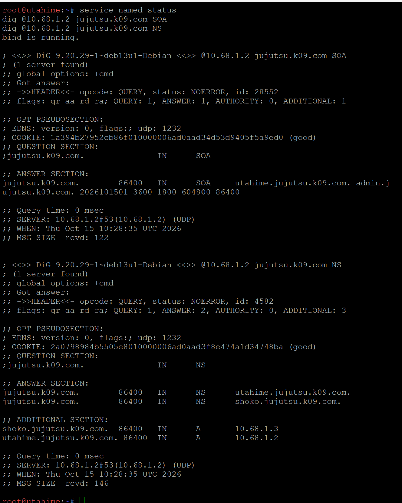

**Nama file foto:** `images/soal11/11-shoko-slave.png`

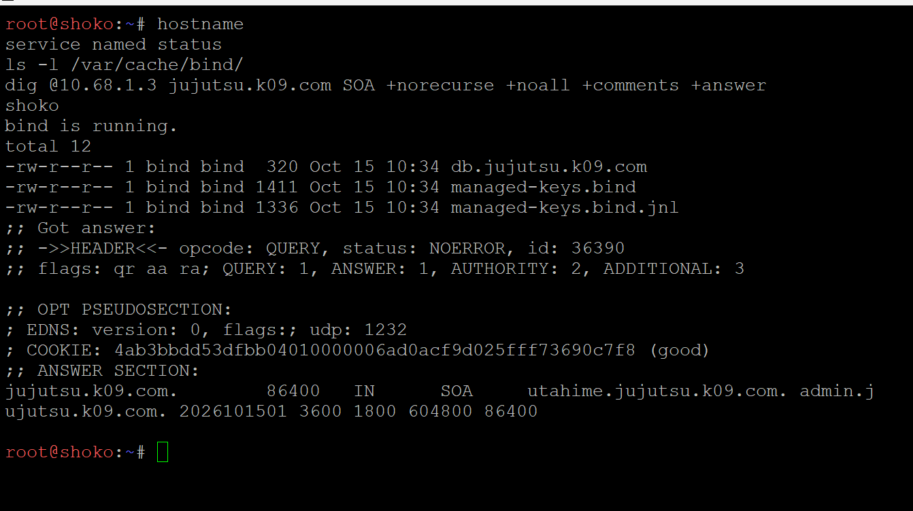

**Nama file foto:** `images/soal11/11-serial-sync-client.png`

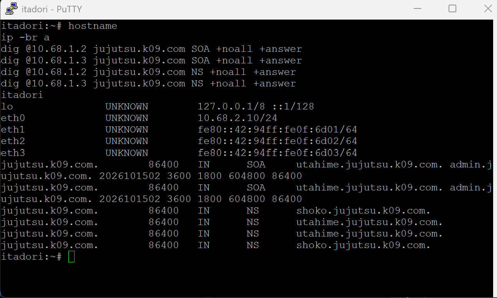

---

## 12. Konfigurasi Record DNS dan Forwarder

Setelah replikasi zona berjalan, record DNS disiapkan untuk mengarahkan domain web ke Gojo. Domain `jujutsu.k09.com` mengarah ke IP reverse proxy `10.68.1.4`, sedangkan `www.jujutsu.k09.com` menggunakan record CNAME. Zona reverse digunakan untuk pencarian PTR host Gojo.

Record yang diuji meliputi:

| Jenis record | Nama atau alamat | Tujuan |
| :--- | :--- | :--- |
| A | `jujutsu.k09.com` | `10.68.1.4` |
| CNAME | `www.jujutsu.k09.com` | `jujutsu.k09.com` |
| PTR | `10.68.1.4` | Nama host Gojo |

Di kedua DNS server, `/etc/bind/named.conf.options` juga dikonfigurasi agar query domain luar diteruskan ke `192.168.122.1`. Pengaturan yang digunakan mencakup `recursion yes;`, `forwarders { 192.168.122.1; };`, dan `forward only;`. Query dari jaringan internal `10.68.0.0/16` diizinkan.

Verifikasi record dari client `itadori`:

```bash
dig @10.68.1.2 jujutsu.k09.com A +noall +answer
dig @10.68.1.3 jujutsu.k09.com A +noall +answer

dig @10.68.1.2 www.jujutsu.k09.com CNAME +noall +answer
dig @10.68.1.3 www.jujutsu.k09.com CNAME +noall +answer

dig @10.68.1.2 -x 10.68.1.4 +short
dig @10.68.1.3 -x 10.68.1.4 +short
```

Untuk memastikan forwarder berfungsi, dilakukan query domain eksternal melalui Master dan Slave, kemudian diuji ping ke domain yang sama.

```bash
dig @10.68.1.2 google.com +short
dig @10.68.1.3 google.com +short
ping -c 3 google.com
```

Hasilnya, record internal dapat dijawab oleh Master maupun Slave. Domain eksternal juga berhasil di-resolve, dan ping dari itadori memperoleh balasan setelah koneksi NAT pada jichi dipastikan aktif.

**Nama file foto:** `images/soal12/12-dns-records-client.png`

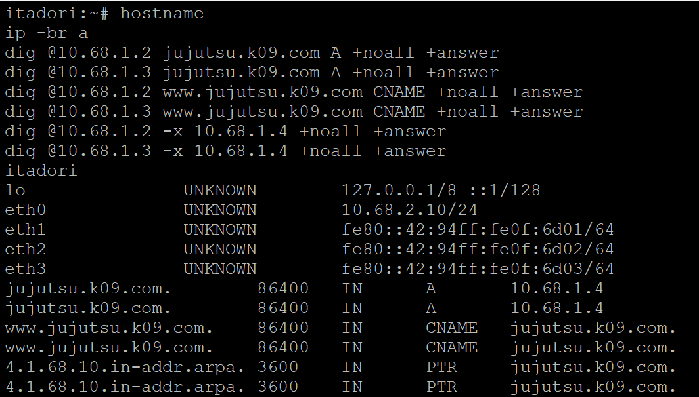

**Nama file foto:** `images/soal12/12-forwarder-ping-client.png`

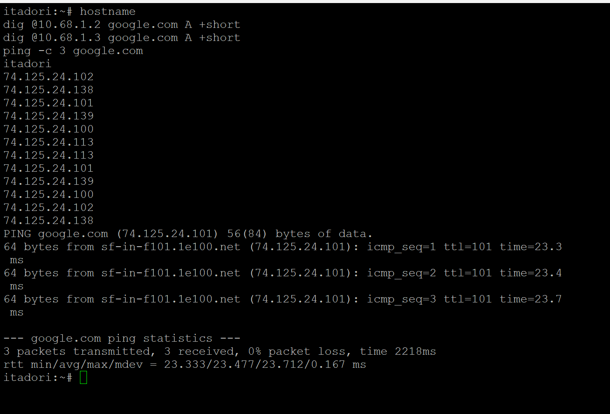

---

## 13. Konfigurasi MariaDB Master-Slave Replication

Database menggunakan `yaga` (`10.68.4.8`) sebagai Master dan `inumaki` (`10.68.4.9`) sebagai Slave. Database yang dibuat bernama `db_shibuya_k09`, dengan tabel `request_logs` untuk menyimpan nama worker, alamat IP client, dan waktu request.

### Konfigurasi MariaDB Master pada yaga

Install MariaDB pada kedua node:

```bash
apt-get update
DEBIAN_FRONTEND=noninteractive apt-get install -y mariadb-server mariadb-client
```

Konfigurasi tambahan Master disimpan dalam `/etc/mysql/mariadb.conf.d/60-k09-master.cnf`:

```ini
[mysqld]
server-id = 1
log_bin = /var/lib/mysql/k09-bin
binlog_format = ROW
bind-address = 10.68.4.8
```

Jalankan MariaDB dan buat struktur database:

```bash
service mariadb start

mariadb -e "CREATE DATABASE IF NOT EXISTS db_shibuya_k09;"
```

Struktur tabel `request_logs`:

```sql
USE db_shibuya_k09;

CREATE TABLE IF NOT EXISTS request_logs (
    id BIGINT UNSIGNED NOT NULL AUTO_INCREMENT PRIMARY KEY,
    worker_name VARCHAR(64) NOT NULL,
    client_ip VARCHAR(45) NOT NULL,
    requested_at TIMESTAMP NOT NULL DEFAULT CURRENT_TIMESTAMP
);
```

Akun `repl_k09` dibuat khusus untuk replikasi dari `10.68.4.9` dengan hak `REPLICATION SLAVE`. Password disimpan dalam berkas lokal `/root/k09-repl-secret.txt` dan tidak dituliskan ke laporan. Akun aplikasi `app_k09` juga disiapkan untuk host `10.68.4.%` dengan hak `SELECT` dan `INSERT` pada tabel `db_shibuya_k09.request_logs`.

Verifikasi konfigurasi Master:

```bash
mariadb -e "SHOW VARIABLES LIKE 'server_id';"
mariadb -e "SHOW VARIABLES LIKE 'log_bin';"
mariadb -e "SHOW VARIABLES LIKE 'binlog_format';"
mariadb -e "SHOW MASTER STATUS\G"
```

Hasil menunjukkan `server_id = 1`, `log_bin = ON`, dan `binlog_format = ROW`. File binary log awal bernama `k09-bin.000001`.

### Konfigurasi MariaDB Slave pada inumaki

Konfigurasi tambahan pada `/etc/mysql/mariadb.conf.d/60-k09-slave.cnf`:

```ini
[mysqld]
server-id = 2
relay-log = /var/lib/mysql/k09-relay
read_only = ON
bind-address = 10.68.4.9
```

Database awal dari yaga disalin melalui snapshot yang mencatat posisi binary log secara konsisten:

```bash
# Dijalankan pada yaga
mariadb-dump --single-transaction --routines --events --master-data=2 \
    --databases db_shibuya_k09 > /root/k09-initial.sql
```

Snapshot dipindahkan ke inumaki menggunakan netcat. Sebelum import, nilai SHA256 file pada kedua node dibandingkan dan hasilnya sama.

```bash
# Dijalankan pada inumaki setelah file diterima
mariadb < /root/k09-initial.sql
```

Posisi yang tercatat pada snapshot adalah file `k09-bin.000001` dengan `MASTER_LOG_POS=1251`. Inumaki dikonfigurasi menggunakan akun `repl_k09` dari yaga dan posisi snapshot tersebut, kemudian replikasi dijalankan menggunakan `START SLAVE;`.

Pemeriksaan status:

```bash
mariadb -e "SHOW SLAVE STATUS\G"
```

Hasil pada inumaki menunjukkan `Slave_IO_Running: Yes`, `Slave_SQL_Running: Yes`, `Seconds_Behind_Master: 0`, dan kolom error kosong.

### Pengujian replikasi dan akses dari Network 4

Data awal dimasukkan di yaga:

```sql
INSERT INTO db_shibuya_k09.request_logs (worker_name, client_ip)
VALUES ('TEST_REPLIKASI_13', '10.68.4.8');
```

Data tersebut muncul pada inumaki dengan ID 1. Pengujian berikutnya dilakukan dari inumaki melalui koneksi TCP menuju yaga menggunakan akun aplikasi `app_k09`. Request `INSERT` remote menghasilkan data `TEST_REMOTE_13` dengan IP `10.68.4.9`, kemudian data yang sama muncul di Slave dengan ID 2.

```bash
mariadb -e "SELECT * FROM db_shibuya_k09.request_logs;"
```

Akses port `3306` yaga dari tengen juga berhasil diuji. Dengan hasil tersebut, koneksi MariaDB dari Network 4 dan replikasi perubahan data pada Master ke Slave sudah berjalan.

**Nama file foto:** `images/soal13/13-master-slave-replikasi-terbukti.png`

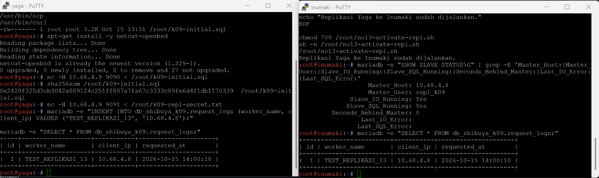

**Nama file foto:** `images/soal13/13-remote-insert-replikasi.png`

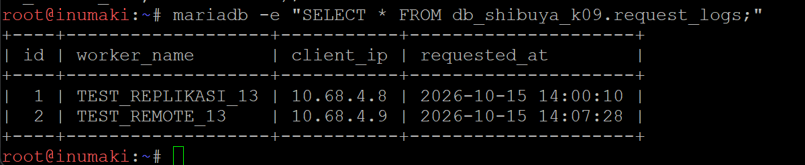

---

## 14. Konfigurasi Frontend dan API Worker

Dua frontend ditempatkan pada `maki` (`10.68.4.3`) dan `panda` (`10.68.4.4`), sedangkan tiga worker API ditempatkan pada `nanami` (`10.68.4.5`), `todo` (`10.68.4.6`), dan `kirara` (`10.68.4.7`).

### Frontend maki dan panda

Kedua frontend dipasang Nginx dan PHP-FPM:

```bash
apt-get update
DEBIAN_FRONTEND=noninteractive apt-get install -y nginx php-fpm php-cli curl
service php8.4-fpm start
service nginx start
```

File `/var/www/html/index.php` menampilkan identitas server secara otomatis menggunakan `gethostname()`. Bagian identitas pada halaman:

```php
<?php
$nama = htmlspecialchars(gethostname(), ENT_QUOTES, 'UTF-8');
$ip = htmlspecialchars($_SERVER['SERVER_ADDR'] ?? '-', ENT_QUOTES, 'UTF-8');
?>
<h1>Frontend K-09</h1>
<p>Server: <?= $nama ?></p>
<p>IP Server: <?= $ip ?></p>
```

Konfigurasi Nginx menggunakan `index index.php index.html;`, `root /var/www/html;`, dan PHP-FPM melalui socket `/run/php/php8.4-fpm.sock`.

```nginx
location / {
    try_files $uri $uri/ /index.php?$query_string;
}

location ~ \.php$ {
    include snippets/fastcgi-php.conf;
    fastcgi_pass unix:/run/php/php8.4-fpm.sock;
}
```

Verifikasi dari masing-masing frontend:

```bash
nginx -t
curl -s http://127.0.0.1/
```

Halaman berhasil dijalankan oleh PHP-FPM dan menampilkan nama server `maki` atau `panda` sesuai node yang diakses.

**Nama file foto:** `images/soal14/14-frontend-maki-panda-php-berhasil.png`

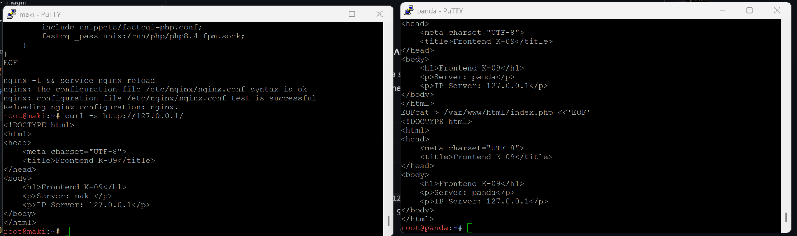

### API worker nanami, todo, dan kirara

Worker dipasang paket `nginx`, `php-fpm`, `php-cli`, dan `php-mysql`. Modul `mysqli` dan `pdo_mysql` diperiksa agar koneksi MariaDB dapat digunakan.

```bash
apt-get update
DEBIAN_FRONTEND=noninteractive apt-get install -y \
    nginx php-fpm php-cli php-mysql curl

service php8.4-fpm start
service nginx start
php -m | grep -Ei 'mysqli|pdo_mysql'
```

File API berada di `/var/www/k09-api/index.php`. Saat endpoint dipanggil, PHP mengambil nama worker dan IP client, lalu menambahkan catatan baru ke database Master yaga:

```php
$worker = gethostname();
$ip = $_SERVER['REMOTE_ADDR'] ?? '';

$db = new mysqli(
    '10.68.4.8',
    'app_k09',
    trim(file_get_contents('/etc/k09-app-secret')),
    'db_shibuya_k09',
    3306
);

$stmt = $db->prepare(
    'INSERT INTO request_logs (worker_name, client_ip) VALUES (?, ?)'
);
$stmt->bind_param('ss', $worker, $ip);
$stmt->execute();
```

File password aplikasi disimpan terpisah pada `/etc/k09-app-secret` dengan permission `640` dan grup `www-data`. Bagian API di Nginx menggunakan FastCGI untuk menjalankan PHP, sedangkan akses endpoint `/api` hanya diizinkan dari Geto (`10.68.4.2`) dan loopback untuk pengujian lokal.

```nginx
location ~ ^/api/?$ {
    allow 10.68.4.2;
    allow 127.0.0.1;
    deny all;

    include /etc/nginx/k09-fastcgi-params;
    fastcgi_param SCRIPT_FILENAME /var/www/k09-api/index.php;
    fastcgi_pass unix:/run/php/php8.4-fpm.sock;
}
```

Pengujian HTTP dilakukan dari Geto:

```bash
curl -i http://10.68.4.5/api
curl -i http://10.68.4.6/api
curl -i http://10.68.4.7/api
```

Ketiga worker akhirnya memberikan `HTTP/1.1 200 OK` dan JSON berisi `status: ok` serta nama worker masing-masing. Pada awal pengujian, Kirara sempat tidak dapat menjangkau Yaga karena MAC address pada interface sama dengan Yaga. MAC Kirara kemudian dibedakan menjadi `02:68:04:00:00:07` sehingga koneksi database kembali berhasil.

---

## 15. Konfigurasi Weighted Load Balancing pada geto

Geto (`10.68.4.2`) digunakan sebagai load balancer untuk API worker. Perbandingan request pada dua worker utama ditetapkan `3:1`, yaitu Nanami dengan bobot 3 dan Todo dengan bobot 1. Kirara disiapkan sebagai server cadangan.

Konfigurasi upstream pada Nginx Geto:

```nginx
upstream k09_api_workers {
    server 10.68.4.5:80 weight=3 max_fails=2 fail_timeout=5s;
    server 10.68.4.6:80 weight=1 max_fails=2 fail_timeout=5s;
    server 10.68.4.7:80 backup;
}
```

Endpoint `/api` diteruskan ke upstream tersebut:

```nginx
location = /api {
    proxy_pass http://k09_api_workers;
    proxy_set_header Host $host;
    proxy_set_header X-Real-IP $remote_addr;
    proxy_set_header X-Forwarded-For $proxy_add_x_forwarded_for;
}
```

Periksa konfigurasi dan jalankan Nginx:

```bash
nginx -t
service nginx restart
```

Pengujian 40 request dari Geto:

```bash
for i in $(seq 1 40); do
    curl -sS --max-time 3 http://127.0.0.1/api
    echo
done | grep -o '"worker":"[^"]*"' | sort | uniq -c
```

Hasil pengujian menunjukkan 31 request ditangani Nanami dan 9 request oleh Todo. Rasio tersebut mendekati target 3:1. Kirara tidak menerima request selama worker utama masih aktif.

**Nama file foto:** `images/soal15/15-geto-weighted-load-balancing.png`

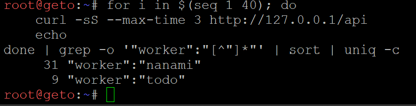

---

## 16. Konfigurasi Reverse Proxy pada gojo

Gojo (`10.68.1.4`) digunakan sebagai reverse proxy untuk domain `jujutsu.k09.com`. Permintaan ke path `/` diarahkan ke Maki dan Panda secara round robin, sementara permintaan ke `/api` diteruskan ke Geto (`10.68.4.2`).

Install Nginx pada Gojo:

```bash
apt-get update
DEBIAN_FRONTEND=noninteractive apt-get install -y nginx curl
```

Konfigurasi `/etc/nginx/sites-available/default`:

```nginx
upstream k09_frontend {
    server 10.68.4.3:80;
    server 10.68.4.4:80;
}

server {
    listen 80 default_server;
    server_name jujutsu.k09.com;

    location = /api {
        proxy_pass http://10.68.4.2;
        proxy_set_header Host $host;
        proxy_set_header X-Real-IP $remote_addr;
        proxy_set_header X-Forwarded-For $proxy_add_x_forwarded_for;
    }

    location / {
        proxy_pass http://k09_frontend;
        proxy_set_header Host $host;
        proxy_set_header X-Real-IP $remote_addr;
        proxy_set_header X-Forwarded-For $proxy_add_x_forwarded_for;
    }
}
```

Setelah `nginx -t` berhasil, service Nginx dijalankan. Pengujian domain dilakukan dari `itadori`:

```bash
dig @10.68.1.2 jujutsu.k09.com +short

for i in $(seq 1 8); do
    curl -s http://jujutsu.k09.com/ \
        | grep -oE 'Server: (maki|panda)'
done

curl -sS -w '\nHTTP: %{http_code}\n' \
    http://jujutsu.k09.com/api
```

DNS mengembalikan `10.68.1.4`, frontend menampilkan identitas Maki dan Panda, sedangkan path `/api` memberikan respons JSON dari worker dengan HTTP `200`. Dengan demikian, akses domain berhasil melewati DNS dan reverse proxy Gojo.

**Nama file foto:** `images/soal16/16-domain-reverse-proxy-gojo.png`

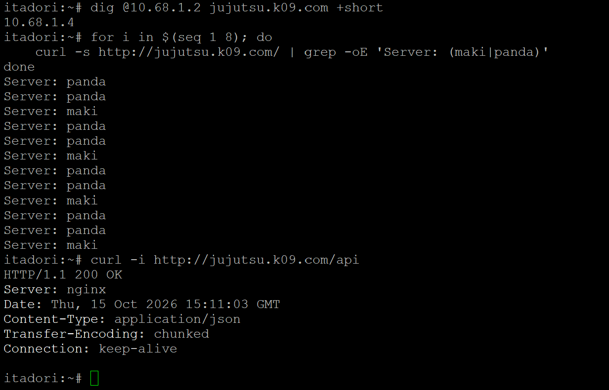

**Nama file foto:** `images/soal16/16-api-json-domain-client.png`

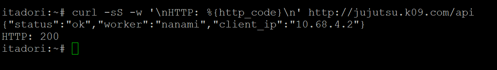

---

## 17. Penerusan IP Asli Client sampai Database

Pada pengujian awal, tabel `request_logs` mencatat `10.68.4.2`, yaitu alamat IP Geto, bukan IP client yang mengakses domain. Konfigurasi kemudian diperbaiki supaya alamat asli dapat diteruskan melalui Gojo, Geto, dan API worker.

Di Gojo, header `X-Real-IP` diisi dari `$remote_addr` client. Pada Geto ditambahkan konfigurasi `/etc/nginx/conf.d/k09-no17-realip.conf`:

```nginx
set_real_ip_from 10.68.1.4;
real_ip_header X-Real-IP;
```

Pengaturan tersebut membuat Geto menerima alamat asli yang diberikan oleh Gojo. Header yang sama selanjutnya diteruskan oleh Geto ke worker.

Di `/var/www/k09-api/index.php` pada Nanami, Todo, dan Kirara, pembacaan IP dibuat hanya mempercayai header `X-Real-IP` apabila koneksi berasal dari Geto:

```php
$peer = $_SERVER['REMOTE_ADDR'] ?? '';
$ip = $peer;

if ($peer === '10.68.4.2') {
    $ip = $_SERVER['HTTP_X_REAL_IP'] ?? $peer;
}
```

### Pengujian dari Network 2 dan Network 3

Dari itadori (`10.68.2.10`), request dilakukan ke endpoint API:

```bash
curl -sS http://jujutsu.k09.com/api
```

Pemeriksaan database pada Yaga:

```bash
mariadb -e "SELECT id,worker_name,client_ip FROM db_shibuya_k09.request_logs ORDER BY id DESC LIMIT 3;"
```

Hasil pengujian pertama mencatat IP Itadori `10.68.2.10` pada data ID 52, sedangkan data sebelumnya masih menunjukkan IP Geto `10.68.4.2`.

Untuk Network 3, kusakabe mendapatkan alamat DHCP dari Tengen menggunakan hostname yang sesuai dengan class `short-lease`:

```sh
udhcpc -i eth0 -x hostname:kusakabe -n -q -t 5 -T 3
ip -br -4 a
curl -sS http://jujutsu.k09.com/api
```

Kusakabe memperoleh `10.68.3.10/24` dengan lease 1800 detik. Setelah mengakses API, tabel Yaga mencatat `10.68.3.10` pada ID 53. Jadi IP asli dari Network 2 dan Network 3 sudah tersimpan di database, bukan hanya IP reverse proxy atau load balancer.

**Nama file foto:** `images/soal17/17-ip-asli-client-database-network2.png`

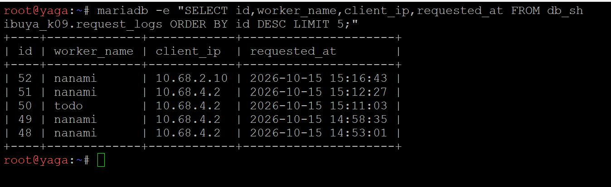

**Nama file foto:** `images/soal17/17-dhcp-kusakabe-api-network3.png`

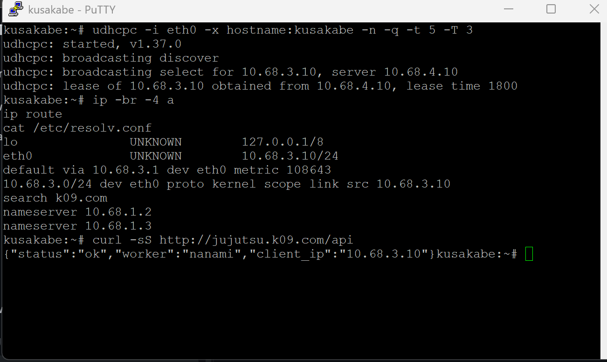

**Nama file foto:** `images/soal17/17-ip-asli-client-network3-database-yaga.png`

<!--  -->

*Foto database Yaga untuk Network 3 belum tersedia di repository.*

---

## 18. Pengujian Failover ke kirara

Kirara (`10.68.4.7`) sudah ditetapkan sebagai `backup` pada konfigurasi upstream Geto. Pada pengujian ini, kedua worker utama dihentikan untuk memastikan API tetap dapat dijalankan melalui server cadangan.

Pengaturan upstream yang digunakan:

```nginx
upstream k09_api_workers {
    server 10.68.4.5:80 weight=3 max_fails=2 fail_timeout=5s;
    server 10.68.4.6:80 weight=1 max_fails=2 fail_timeout=5s;
    server 10.68.4.7:80 backup;
}
```

Matikan Nginx pada kedua worker utama:

```bash
# Pada nanami
service nginx stop

# Pada todo
service nginx stop
```

Kemudian jalankan delapan request dari Geto:

```bash
for i in $(seq 1 8); do
    curl -sS --max-time 5 \
        -w ' HTTP:%{http_code}\n' \
        http://127.0.0.1/api
done
```

Seluruh delapan request memberikan `HTTP:200` dengan `worker: kirara`. Tidak ada respons HTTP `502` pada pengujian ini sehingga failover dapat berjalan saat dua worker utama tidak tersedia.

Setelah pengujian, Nginx pada Nanami dan Todo dinyalakan kembali. Pembagian 12 request dari Geto kemudian menunjukkan 9 request ke Nanami dan 3 ke Todo, menandakan dua worker utama sudah aktif lagi.

**Nama file foto:** `images/soal18/18-kirara-failover.png`

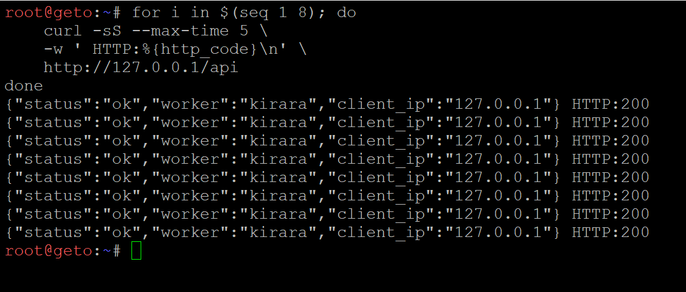

---

## 19. Konfigurasi Cache Frontend dan Rate Limiting API

Pada Gojo ditambahkan cache frontend selama 10 menit dan pembatasan API sebesar 10 request per detik untuk setiap alamat IP.

Konfigurasi zona pada `/etc/nginx/conf.d/k09-performance.conf`:

```nginx
proxy_cache_path /var/cache/nginx/k09
    levels=1:2
    keys_zone=k09_cache:10m
    max_size=50m
    inactive=10m
    use_temp_path=off;

limit_req_zone $binary_remote_addr
    zone=k09_api_limit:10m
    rate=10r/s;
```

### Cache frontend selama 10 menit

Konfigurasi pada blok `location /` di Nginx Gojo:

```nginx
proxy_cache k09_cache;
proxy_cache_valid 200 10m;
proxy_cache_key "$scheme$host$request_uri";
add_header X-Cache-Status $upstream_cache_status always;
```

Verifikasi dilakukan menggunakan dua request berurutan ke frontend:

```bash
curl -sI -H 'Host: jujutsu.k09.com' http://127.0.0.1/ \
    | grep -Ei 'HTTP/|X-Cache-Status'

curl -sI -H 'Host: jujutsu.k09.com' http://127.0.0.1/ \
    | grep -Ei 'HTTP/|X-Cache-Status'
```

Pada hasil pengujian, request pertama memberikan `X-Cache-Status: MISS` dan request kedua `X-Cache-Status: HIT`. Keduanya mendapatkan HTTP `200 OK`.

**Nama file foto:** `images/soal19/19-gojo-cache-miss-hit.png`

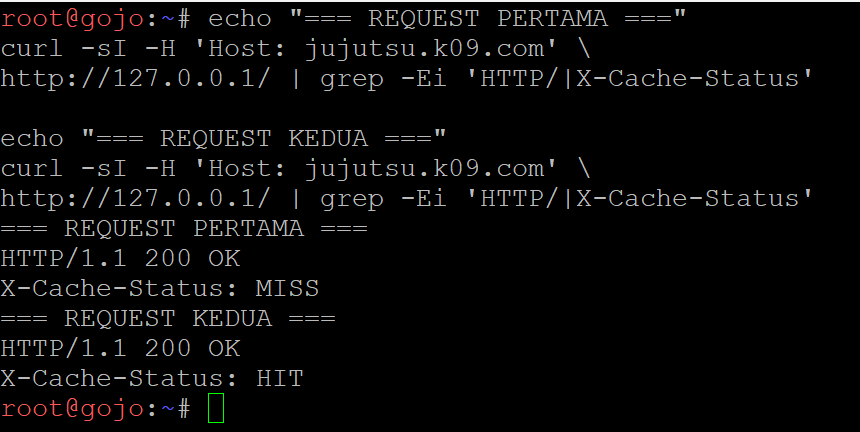

### Rate limit API per alamat IP

Pada blok `location = /api` di Gojo digunakan:

```nginx
limit_req zone=k09_api_limit burst=10 nodelay;
limit_req_status 429;
```

Dengan pengaturan tersebut, request di atas batas akan dijawab dengan HTTP `429 Too Many Requests`. Pengujian dilakukan dari Kusakabe dengan 50 request paralel:

```bash
seq 1 50 | xargs -P 20 -I {} sh -c \
'curl -s -o /dev/null -w "%{http_code}\n" --max-time 5 http://jujutsu.k09.com/api' \
| sort | uniq -c
```

Hasilnya 11 request mendapat HTTP `200` dan 39 request mendapat HTTP `429`. Artinya pembatasan API sudah bekerja, sedangkan request frontend tetap bisa dilayani melalui cache.

**Nama file foto:** `images/soal19/19-api-rate-limit.png`

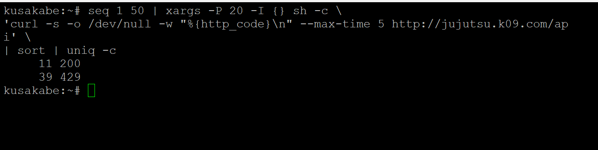

---

## 20. Benchmark ApacheBench dan Analisis Hasil

Benchmark dilakukan dari `kusakabe` (`10.68.3.10`) menggunakan ApacheBench. Pengujian pertama diarahkan ke frontend sebanyak 600 request dengan concurrency 30. Setelah itu dilakukan perbandingan endpoint API sebelum dan sesudah rate limiting aktif.

### Benchmark frontend 600 request

```bash
ab -l -n 600 -c 30 -s 10 \
    http://jujutsu.k09.com/ \
    | tee /root/k09-frontend-600.txt
```

Hasil benchmark frontend:

| Parameter | Hasil |
| :--- | ---: |
| Complete requests | 600 |
| Concurrency level | 30 |
| Failed requests | 0 |
| Requests per second | 5797.27 req/s |
| Time per request | 5.175 ms |
| Time taken for tests | 0.103 detik |
| Persentil 95 | 7 ms |
| Request terlama | 12 ms |

Sebanyak 600 request selesai tanpa kegagalan. Pengujian dilakukan setelah cache Gojo aktif, sehingga nilai throughput juga dipengaruhi oleh respons frontend yang dilayani dari cache.

**Nama file foto:** `images/soal20/20-benchmark-frontend-600-c30.png`

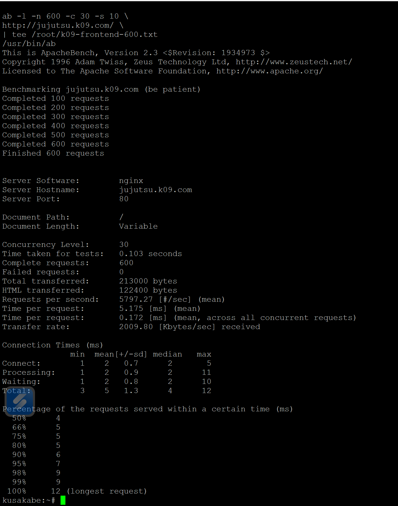

### Perbandingan API sebelum dan sesudah rate limiting

Pengujian API dilakukan dengan 100 request dan concurrency 20. Opsi `-l` digunakan karena panjang respons masing-masing worker dapat berbeda.

```bash
# Baseline sebelum rate limiting aktif
ab -l -n 100 -c 20 -s 10 \
    http://jujutsu.k09.com/api \
    | tee /root/k09-api-baseline.txt

# Setelah rate limiting aktif
ab -l -n 100 -c 20 -s 10 \
    http://jujutsu.k09.com/api \
    | tee /root/k09-api-limited.txt
```

Perbandingan hasil:

| Parameter | Sebelum limit | Setelah limit |
| :--- | ---: | ---: |
| Complete requests | 100 | 100 |
| Concurrency level | 20 | 20 |
| Failed requests | 0 | 0 |
| Requests per second | 439.00 | 93.78 |
| Time per request | 45.559 ms | 213.266 ms |
| Non-2xx responses | Tidak tercantum pada ringkasan baseline | 88 |

Setelah rate limit aktif, throughput API menjadi lebih rendah karena sebagian request ditolak sesuai aturan. Nilai `Failed requests: 0` tidak berarti semua request mendapat HTTP 200, karena ApacheBench mencatat respons HTTP di luar 2xx secara terpisah.

**Nama file foto:** `images/soal20/20-benchmark-api-sebelum-sesudah-rate-limit.png`

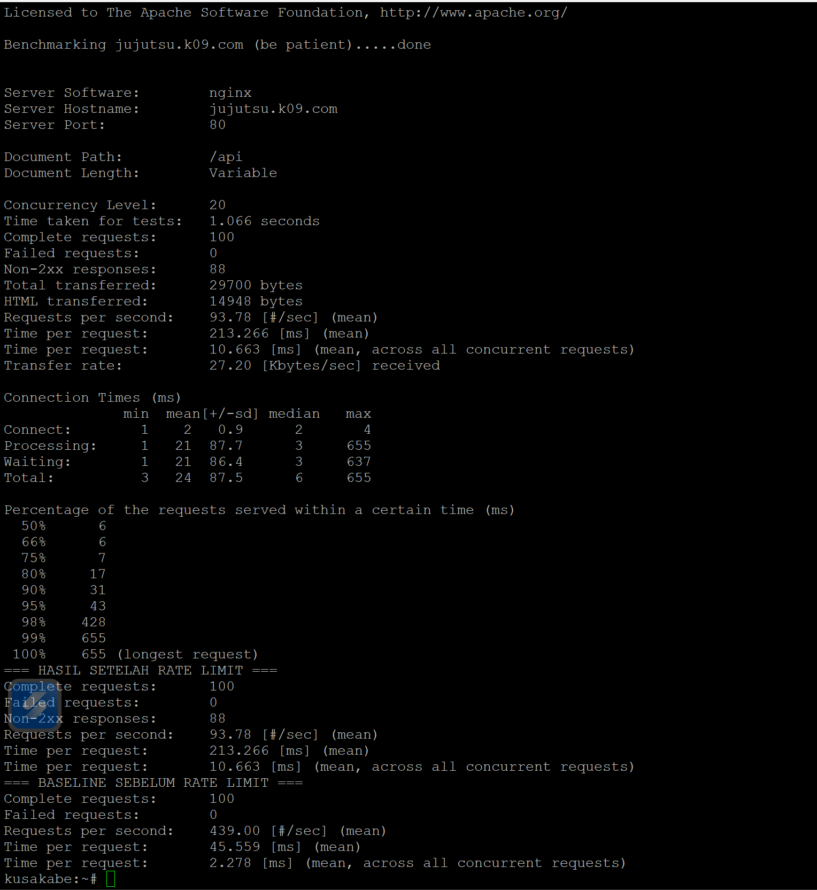

### Verifikasi access log Nginx Gojo

Untuk melihat status HTTP yang benar-benar tercatat, dilakukan pemeriksaan 100 request API terakhir pada `/var/log/nginx/access.log`:

```bash
grep '"GET /api ' /var/log/nginx/access.log \
    | tail -n 100 \
    | awk '{count[$9]++} END {for (s in count) print s, count[s]}' \
    | sort -n

grep '"GET /api ' /var/log/nginx/access.log | tail -n 10
```

Log memperlihatkan 12 respons HTTP `200` dan 88 respons HTTP `429` dari IP Kusakabe `10.68.3.10`. Jumlah 88 respons 429 sesuai dengan `Non-2xx responses` pada hasil ApacheBench setelah rate limiting. Dengan demikian, pembatasan request terbukti berjalan dan tercatat di access log Nginx.

**Nama file foto:** `images/soal20/20-gojo-access-log-api-200-429.png`

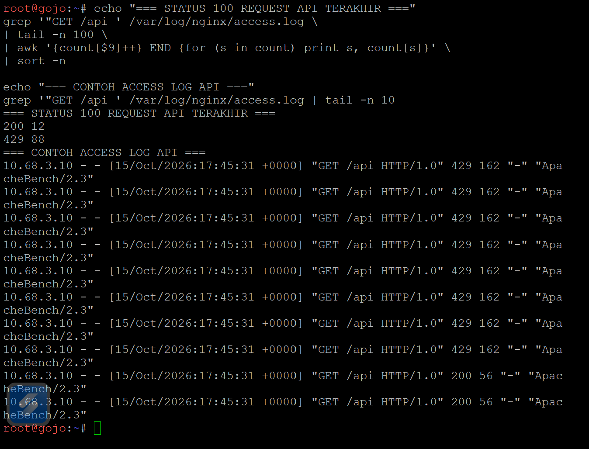
